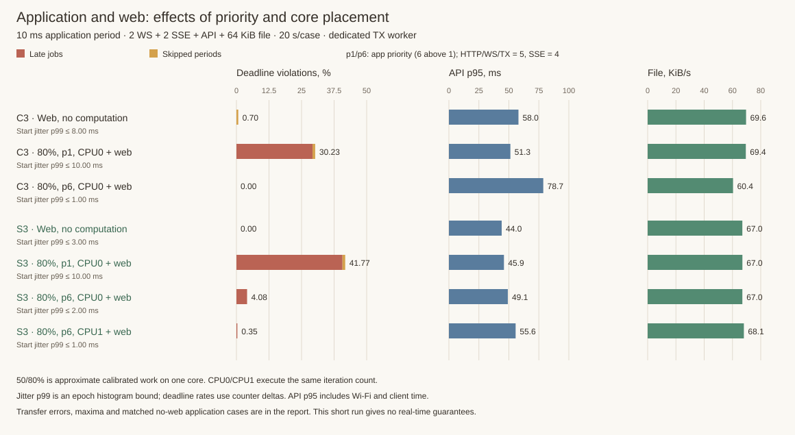
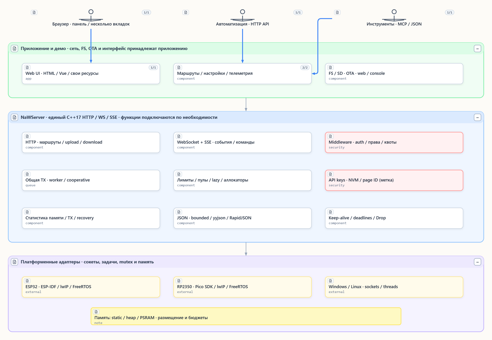
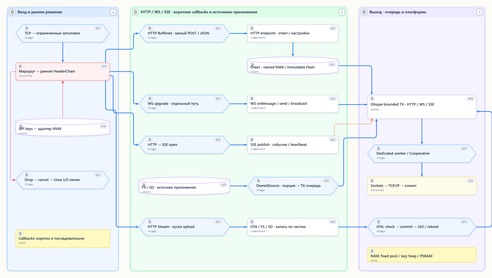
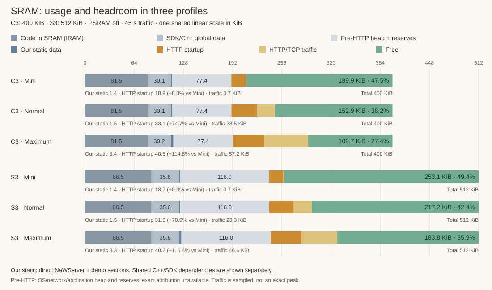
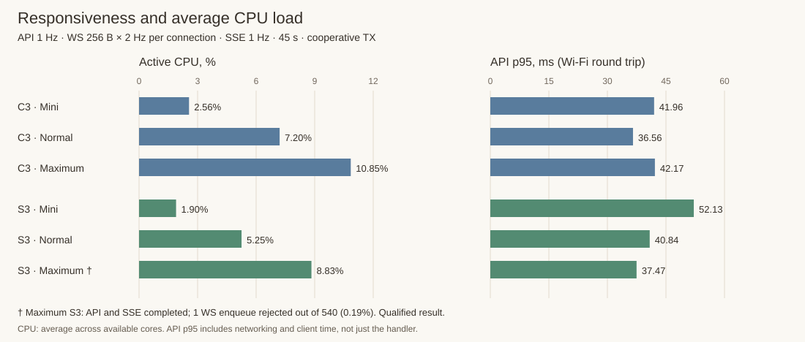

# NaWServer

[Русский](Readme.ru.md) · [Documentation](docs/README.md) · [Examples](examples/) · [MIT](LICENSE)

**HTTP, WebSocket and SSE in C++17 for ESP32, RP2350, Windows and Linux.**
One server engine, configurable memory and client limits, streaming transfers and
one shared transmission queue. From a small device API to a telemetry dashboard.

## Asynchronous I/O: the application works while the web responds

The device's main task keeps measuring, controlling and computing while the server
serves pages, accepts settings and sends WS/SSE updates. Application code should
not wait for a browser to finish reading a file: managed HTTP retains bounded state
and yields body/TX waits so other connections can progress.

Short callbacks accept commands and provide data; lengthy work runs in a separate
bounded application task. Memory/TX budgets and the queue executor are configurable;
the application sets its own task priority. These mechanisms separate work;
available CPU time and callback duration determine actual latency.

We measure both sides: **API/WS/SSE latency and application task deadlines**, not just
CPU percentages. The [concurrent workload fixture](docs/readme_async_workload_ru.md)
compares identical web traffic with no computation, with computation and with
different task priorities/cores.

<!-- ASYNC_OVERVIEW_EN -->

On C3, raising application priority from 1 to 6 changed deadline violations
from **30.23% to 0.00% in the 20-second window**, and API p95 from **51.3 to 78.7 ms
(+53.5%)**. Priority distributes responsiveness between application work and web traffic.

<!-- /ASYNC_OVERVIEW_EN -->

## Capabilities and selection

- **Portability.** Shared HTTP/WS code over lwIP/BSD sockets, Winsock or Linux;
  an ESP-IDF component and standalone CMake target. Select `NAWSERVER_PLATFORM`.
- **HTTP API.** Methods, exact/prefix routes, query/form parsing, headers and responses.
  Static `Route` tables; bounds through `HttpLimits`.
- **Website assets.** Text/binary data, MIME, cache headers and precompressed gzip.
  `HandlerStaticUriText/Bin`, `ResponseOptions`; no runtime compressor required.
- **Large uploads/downloads.** `BodyMode::Buffered` for small bodies,
  `BodyMode::Stream` for large ones. `sendOwnedSource()` serves files in bounded
  chunks; the application supplies FS/SD sources and upload sinks. Requires the managed engine.
- **WebSocket.** Text/binary messages, broadcast, fragmented input and ping/pong.
  `NAWSERVER_WEBSOCKET`; bounds through `WebSocketLimits`.
- **SSE.** Events, id/retry, heartbeat and bounded sessions.
  `NAWSERVER_SSE`, `sse::Limits`; currently at most 4 clients per `EventSource`.
- **Middleware.** Static chains, early HTTP admission before body reads and terminal
  `Drop`. Authentication: `NAWSERVER_AUTH`; quotas: `NAWSERVER_CLIENT_QUOTAS`.
  The early HeaderChain also runs before WS upgrade; ordinary HTTP endpoint middleware is not its replacement.
- **API keys and page labels.** Bounded `keys::Store`, create/rotate/revoke,
  NVM adapters. `NAWSERVER_API_KEYS`; demos include web/console management.
  Page ID is a nonsecret document label for accounting, not authentication.
- **Memory management.** Initial minimum plus bounded growth, fixed pools and custom
  allocators; RAM/PSRAM on ESP. `NAWSERVER_TCP_MANAGED`,
  `TcpOptions.http_memory` / `buffer_memory`.
- **Shared HTTP/WS/SSE TX queue.** Block/byte limits, priorities and payload ownership.
  `TcpOptions.transmission.enabled`; `TransmissionExecution` selects a separate
  `DedicatedWorker` or `Cooperative` steps in the existing I/O loop.
- **Keep-alive and recovery.** Bounded sequential HTTP/1.1 requests, deadlines and
  listener restart. `TcpOptions.keep_alive` / `recovery`.
- **Diagnostics.** Connections, memory, rejections and TX: `diagnostics()`,
  `bufferMemoryStats()`, `managedMemoryStats()`, `transmissionStats()`.
- **Optional JSON/MCP.** `NAWSERVER_MCP` and exactly one reader:
  `NAWSERVER_JSON_BOUNDED`, `NAWSERVER_JSON_YYJSON` or `NAWSERVER_JSON_RAPIDJSON`.
  MCP implements a bounded tools profile; the application supplies its workspace.

## Data and event paths

HTTP passes route selection and early middleware before body reads. Short callbacks
run serially. Streaming bodies and yielding body/TX waits require
`NAWSERVER_TCP_MANAGED` and enabled `TcpOptions.http_memory.enabled`. File output uses bounded
chunks through a work buffer and TX. Enqueue success does not mean client delivery
or a TCP ACK.

Networking, FS mounting, UI and OTA belong to the application. The same streaming
input API can write a file, SD or an inactive firmware slot; image validation and
reboot remain platform-specific. Example Vue/CBOR, LCD and OTA are not core dependencies.
The authored SeMaps diagrams above use Russian captions.

## Memory and speed on hardware

Bench dated 2026-11-06: **ESP-IDF 5.5.6, Release/O3, PSRAM off, cooperative TX**.
Every profile has one API client. Tabs are modeled as separate WS/SSE connections:
256-byte WS echo at 2 Hz plus 1 Hz telemetry, 1 Hz SSE/API, 408-byte HTML reload every 2 s.
Each window lasts 45 s. These compare configurations, not arbitrary dashboard capacity.

| Profile | WS | SSE | TCP limit | Intended use |
|---|---:|---:|---:|---|
| Mini | 0 | 0 | 2 | One API without a persistent dashboard |
| Normal | 3 | 0 | 6 | Three pages with bidirectional traffic |
| Tested maximum | 6 | 4 | 13 | Six pages; four also consume SSE |

All bar and segment lengths are strictly proportional to bytes on one shared scale:
C3 has 400 KiB, S3 has 512 KiB. Label percentages use each board's own SRAM capacity.

Before HTTP, C3 Mini already uses/reserves **190.4 KiB / 47.6% of SRAM** for resident
code, globals and initial OS/network/application allocations and reserves. The chart
now splits this common base: directly attributed static data is **1.4 KiB** and
**HTTP startup adds 18.9 KiB of heap**. Shared dependencies are not all charged to NaWServer.

**The page stays in Flash**, in `.flash.rodata`: 7,773 gzip bytes in the compact demo,
408 bytes in this fixture. `sendImmutable()` does not make a full RAM copy;
bounded work and network buffers are still needed for transmission.

<!-- PROFILE_TABLE_EN -->

| Board / profile | Startup heap, KiB | Free under load, KiB / % SRAM | CPU idle → active, % | API p95, ms | Result |
|---|---:|---:|---:|---:|---|
| C3 · Mini | 18.9 | 189.9 / 47.5% | 1.42 → 2.56 | 42.0 | OK |
| C3 · Normal | 33.1 | 152.9 / 38.2% | 1.58 → 7.20 | 36.6 | OK |
| C3 · Maximum | 40.6 | 109.7 / 27.4% | 1.69 → 10.85 | 42.2 | OK |
| S3 · Mini | 18.7 | 253.1 / 49.4% | 1.11 → 1.90 | 52.1 | OK |
| S3 · Normal | 31.9 | 217.2 / 42.4% | 1.16 → 5.25 | 40.8 | OK |
| S3 · Maximum | 40.2 | 183.8 / 35.9% | 1.28 → 8.83 | 37.5 | 1 WS rejection † |

<!-- /PROFILE_TABLE_EN -->

<!-- PROFILE_FINDINGS_EN -->

From Mini to the maximum profile, free heap fell by **42.2% on C3 / 27.4% on S3**.
Maximum S3 completed with **one WS enqueue rejection out of 540 (0.19%)**; API and all four SSE streams worked.
Retrying transient SSE `Busy` removed skipped publications in the fixture; the largest SSE gap reached 1.73 s.
A short run does not prove soak stability or guaranteed latency.

<!-- /PROFILE_FINDINGS_EN -->

In a separate matched one-GET test, the plain engine required about **12.2 KB startup
heap versus ESP-IDF HTTPD's 11.5 KB: +6.1%**. Managed HTTP + TX with a dedicated task
required about **27 KB: +134%**, paying for work slots, queues and their execution.
These offer different capabilities. In the compact demo, cooperative execution saved
**4,484 B / about 11.4% of startup cost** versus the TX task; transmission progress
then depends on the existing I/O loop.

[Method, exact bytes and test limits](docs/readme_profile_benchmarks_ru.md) ·
[Subsystem costs with HTTPD alongside](examples/compact/MEMORY_BRICKS_RU.md) ·
[S3 RAM/PSRAM placement](examples/compact/PSRAM_PLACEMENT_MEASUREMENTS_RU.md)

## Fit and tradeoffs

Local APIs, device setup, telemetry and file updates without buffering the entire
upload. The common engine preserves application routes across platforms; explicit
budgets help leave RAM for the main application, such as LVGL. GUI headroom depends
on the display, draw buffers and PSRAM placement.

Management costs metadata, work slots and tasks. Long callbacks delay other clients;
move lengthy work to a bounded application job with a job identifier. TLS/WSS,
HTTP pipelining, incoming chunked Transfer-Encoding and arbitrary deferred HTTP
completion are not implemented. Native ESP-IDF HTTPD is no longer supported.

## Demos — explore and try

- **[Full ESP32 dashboard](examples/showcase/README.md)** — Vue interface with CPU/memory charts,
  live WS/SSE and an HTTP/CBOR lab. Includes a local simulator requiring no board.
- **[S3 with a 7″ touchscreen](examples/touch_lcd7/README.md)** — web dashboard,
  LCD control through LVGL and touch checks.
- **[Pico 2 W / RP2350](examples/rp2350_pico2_w/README.md)** — the same dashboard on FreeRTOS SMP:
  per-core CPU load, LittleFS assets and persistent NVM settings.
- **[C6 with a 1.47″ screen](examples/c6_lcd147/README.md)** — dashboard port for C6,
  onboard LCD and RGB LED checks.
- **[Compact device](examples/compact/README.md)** — a practical minimum without Vue:
  one API key, two SSE pages, settings and OTA.

For your own project: [client and Vue components](frontend/README.md) ·
[build](docs/readme_portable_build_ru.md) · [SDK](docs/readme_development_environment_ru.md) ·
[API](docs/README.md) · [SeMaps architecture](docs/readme_architecture_ru.md).

Project-authored code is MIT; vendor files retain their licenses:
[notices](THIRD_PARTY_NOTICES.md), [provenance review](docs/reviews/2026-10-30_provenance.md),
[public snapshot audit](docs/reviews/2026-11-07_publication.md).
