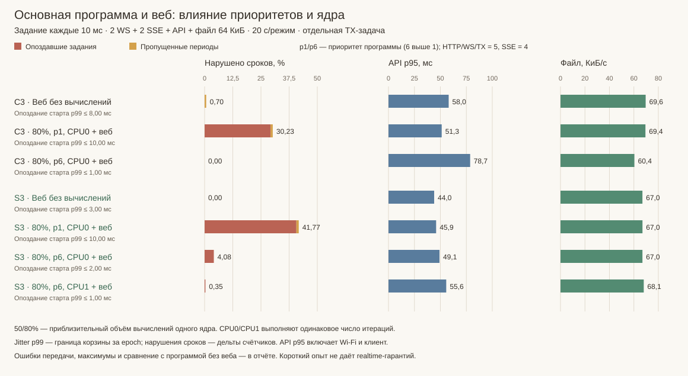
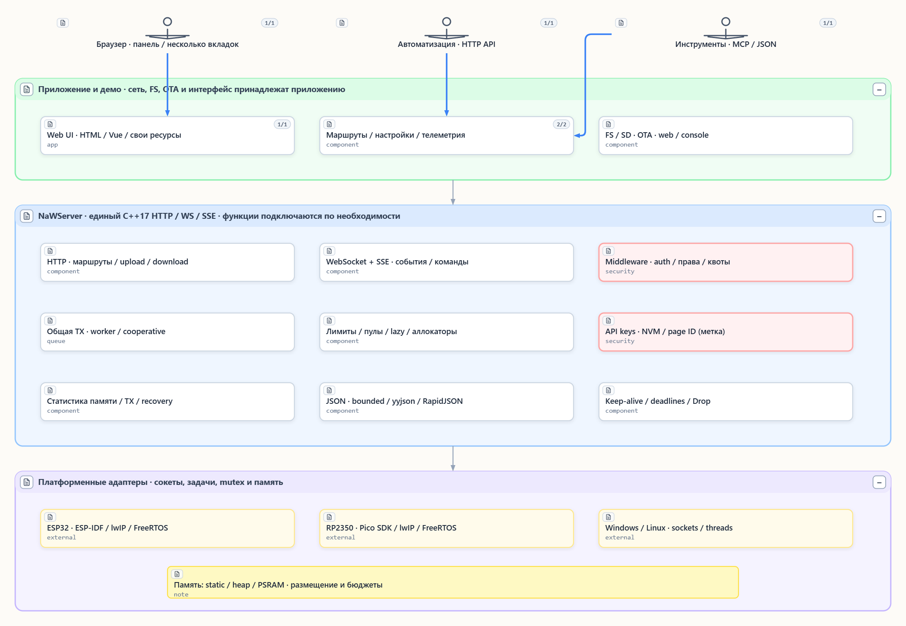
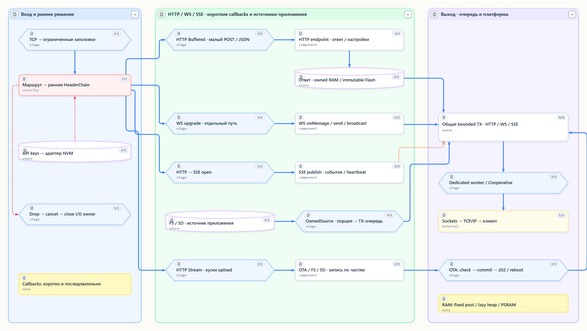
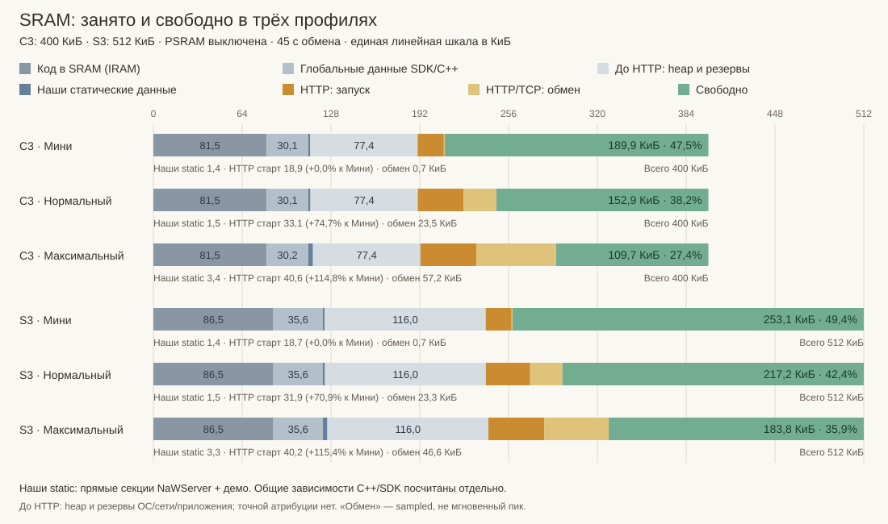
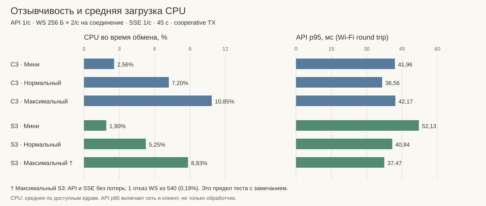

# NaWServer

[English](Readme.md) · [Документация](docs/README.md) · [Примеры](examples/) · [MIT](LICENSE)

**HTTP, WebSocket и SSE на C++17 для ESP32, RP2350, Windows и Linux.**
Один серверный движок, настраиваемые пределы памяти и клиентов, потоковые загрузки
и общая очередь передачи. От небольшого API устройства до панели с телеметрией.

## Асинхронность: основная программа работает, веб отвечает

Главная задача устройства продолжает измерять, управлять и вычислять, пока сервер
отдаёт страницы, принимает настройки и передаёт WS/SSE. Прикладной код не должен
ждать, пока браузер прочитает файл: managed HTTP сохраняет ограниченное состояние,
а ожидание тела или места в TX уступает обработку другим соединениям.

Короткие callbacks принимают команды и передают данные; длительная работа выполняется
в отдельной ограниченной прикладной задаче. Настраиваются бюджеты памяти и TX,
исполнитель очереди; приложение задаёт приоритет своей задачи ОС. Это даёт средства разделения работы;
доступное CPU-время и длительность callbacks определяют реальные задержки.

Проверяем обе стороны: **задержку API/WS/SSE и сроки основной задачи**, а не только
проценты CPU. [Стенд совместной нагрузки](docs/readme_async_workload_ru.md) сравнивает
одинаковый веб-обмен без вычислений, с вычислениями и с изменением приоритета/ядра.

<!-- ASYNC_OVERVIEW_RU -->

На C3 повышение приоритета программы с 1 до 6 изменило долю нарушенных сроков
с **30,23% до 0,00% в 20-секундном окне**, а API p95 — с **51,3 до 78,7 мс
(+53,5%)**. Так приоритет распределяет отзывчивость между программой и вебом.

<!-- /ASYNC_OVERVIEW_RU -->

## Что умеет и как выбирается

- **Переносимость.** Общий HTTP/WS-код поверх lwIP/BSD sockets, Winsock или Linux;
  ESP-IDF component и самостоятельная CMake-цель. Платформа — `NAWSERVER_PLATFORM`.
- **HTTP API.** Методы, точные/префиксные маршруты, query/form, заголовки и ответы.
  Статические таблицы `Route`, ограничения — `HttpLimits`.
- **Ресурсы сайта.** Текст, бинарные данные, MIME, cache-заголовки, готовый gzip.
  `HandlerStaticUriText/Bin`, `ResponseOptions`; runtime-компрессор не нужен.
- **Большие upload/download.** Малое тело — `BodyMode::Buffered`, большое —
  `BodyMode::Stream`. `sendOwnedSource()` отдаёт файл порциями без всего файла в RAM;
  источники FS/SD и обработчики записи предоставляет приложение. Требуется managed engine.
- **WebSocket.** Текст, бинарные сообщения, broadcast, входные фрагменты, ping/pong.
  `NAWSERVER_WEBSOCKET`, лимиты — `WebSocketLimits`.
- **SSE.** События, id/retry, heartbeat и ограниченные сессии.
  `NAWSERVER_SSE`, `sse::Limits`; текущий предел — 4 клиента на `EventSource`.
- **Middleware.** Статические цепочки, ранний допуск до HTTP body и терминальный `Drop`.
  Аутентификация — `NAWSERVER_AUTH`, квоты — `NAWSERVER_CLIENT_QUOTAS`.
  Ранняя HeaderChain работает и до WS upgrade; middleware обычного HTTP endpoint её не заменяет.
- **API-ключи и метки страниц.** Ограниченный `keys::Store`, создание/ротация/отзыв,
  адаптеры NVM. `NAWSERVER_API_KEYS`; web/консоль управления есть в демо.
  Page ID — несекретная метка вкладки для учёта, а не пароль.
- **Управление памятью.** Начальный минимум + ограниченный рост, фиксированные пулы
  и свои аллокаторы; на ESP — RAM/PSRAM. `NAWSERVER_TCP_MANAGED`,
  `TcpOptions.http_memory` / `buffer_memory`.
- **Общая TX-очередь HTTP/WS/SSE.** Лимиты блоков/байтов, приоритеты, владение данными.
  `TcpOptions.transmission.enabled`; `TransmissionExecution` выбирает отдельную задачу
  `DedicatedWorker` либо `Cooperative` в существующем I/O-цикле.
- **Keep-alive и восстановление.** Ограниченные последовательные HTTP/1.1-запросы,
  deadlines, перезапуск listener. `TcpOptions.keep_alive` / `recovery`.
- **Диагностика.** Соединения, память, отказы и TX: `diagnostics()`,
  `bufferMemoryStats()`, `managedMemoryStats()`, `transmissionStats()`.
- **Необязательные JSON/MCP.** `NAWSERVER_MCP` и ровно один reader:
  `NAWSERVER_JSON_BOUNDED`, `NAWSERVER_JSON_YYJSON` или `NAWSERVER_JSON_RAPIDJSON`.
  MCP — ограниченный профиль инструментов; workspace задаёт приложение.

## Как идут данные

HTTP проходит выбор маршрута и ранние middleware до чтения тела. Короткие callbacks
выполняются последовательно. Потоковые тела и уступающее ожидание требуют
`NAWSERVER_TCP_MANAGED` и включённого `TcpOptions.http_memory.enabled`. Файл читается
ограниченными порциями через рабочий буфер и TX. Постановка в очередь не означает
получение клиентом или TCP ACK.

Сеть, монтирование FS, UI и OTA принадлежат приложению. Один потоковый входной API
подходит для файла, SD и неактивного слота прошивки; проверка образа и перезагрузка
остаются платформенными. Vue/CBOR, LCD и OTA из примеров — не зависимости ядра.

## Память и скорость на реальных платах

Стенд 06.11.2026: **ESP-IDF 5.5.6, Release/O3, PSRAM выключена, cooperative TX**.
Во всех профилях один API-клиент. Вкладки моделируются отдельными WS/SSE-соединениями:
WS echo 256 Б × 2/с + телеметрия 1/с, SSE 1/с, API 1/с, HTML 408 Б раз в 2 с. Окно — 45 с.
Это сравнение конфигураций, а не обещание вместимости произвольной панели.

| Профиль | WS | SSE | TCP-лимит | Назначение |
|---|---:|---:|---:|---|
| Мини | 0 | 0 | 2 | Одно API без постоянной панели |
| Нормальный | 3 | 0 | 6 | Три страницы с двусторонним обменом |
| Максимальный в тесте | 6 | 4 | 13 | Шесть страниц; четыре дополнительно используют SSE |

Длина всех полос и сегментов строго пропорциональна байтам в единой шкале:
C3 — 400 КиБ, S3 — 512 КиБ. Проценты в подписях относятся к SRAM своей платы.

До HTTP у C3 «Мини» уже занято/недоступно **190,4 КиБ / 47,6% SRAM**: код в SRAM,
глобальные данные и начальные выделения/резервы ОС, сети и приложения. Эта общая
основа теперь разложена на графике; наши прямые статические данные — **1,4 КиБ**,
**запуск HTTP добавляет 18,9 КиБ heap**. Общие зависимости не целиком приписаны NaWServer.

**Страница хранится во Flash**, в `.flash.rodata`: 7 773 Б gzip в компактном демо,
408 Б в этом стенде. `sendImmutable()` не создаёт полную копию страницы в RAM;
для передачи остаются ограниченные рабочие и сетевые буферы.

<!-- PROFILE_TABLE_RU -->

| Плата / профиль | Heap старта, КиБ | Свободно при обмене, КиБ / % SRAM | CPU простой → обмен, % | API p95, мс | Результат |
|---|---:|---:|---:|---:|---|
| C3 · Мини | 18,9 | 189,9 / 47,5% | 1,42 → 2,56 | 42,0 | OK |
| C3 · Нормальный | 33,1 | 152,9 / 38,2% | 1,58 → 7,20 | 36,6 | OK |
| C3 · Максимальный | 40,6 | 109,7 / 27,4% | 1,69 → 10,85 | 42,2 | OK |
| S3 · Мини | 18,7 | 253,1 / 49,4% | 1,11 → 1,90 | 52,1 | OK |
| S3 · Нормальный | 31,9 | 217,2 / 42,4% | 1,16 → 5,25 | 40,8 | OK |
| S3 · Максимальный | 40,2 | 183,8 / 35,9% | 1,28 → 8,83 | 37,5 | 1 отказ WS † |

<!-- /PROFILE_TABLE_RU -->

<!-- PROFILE_FINDINGS_RU -->

От Мини к максимальному профилю свободный heap уменьшился на **42,2% у C3 / 27,4% у S3**.
У S3 максимальный тест завершился с **одним отказом WS из 540 (0,19%)**; API и четыре SSE работали.
Повтор временного SSE `Busy` устранил пропуски публикаций в стенде; максимальная пауза SSE достигала 1,73 с.
Короткий прогон не доказывает длительную устойчивость или гарантированную задержку.

<!-- /PROFILE_FINDINGS_RU -->

В отдельном одинаковом тесте «один GET» простое ядро потребовало около **12,2 КБ heap
при старте против 11,5 КБ ESP-IDF HTTPD: +6,1%**. Managed HTTP + TX с отдельной задачей —
около **27 КБ: +134%**, за рабочие места, очереди и обслуживание. Наборы возможностей
различаются. В компактном демо cooperative вместо TX-задачи экономил **4 484 Б / около
11,4% стартового расхода**; продвижение TX при этом зависит от существующего I/O-цикла.

[Методика, точные байты и ограничения](docs/readme_profile_benchmarks_ru.md) ·
[Стоимость по подсистемам и HTTPD рядом](examples/compact/MEMORY_BRICKS_RU.md) ·
[RAM/PSRAM на S3](examples/compact/PSRAM_PLACEMENT_MEASUREMENTS_RU.md)

## Где полезен и какие есть ограничения

Локальный API, настройки, телеметрия, обновление файлов без буфера на весь upload.
Общий движок сохраняет прикладные маршруты при смене платформы; бюджеты помогают
оставить RAM под основную задачу, например LVGL. Резерв для GUI зависит от дисплея,
draw buffers и размещения в PSRAM.

Плата за управляемость — метаданные, рабочие места и задачи. Долгие callbacks задерживают
остальных; их выносят в ограниченную прикладную задачу с job-id. TLS/WSS, HTTP pipelining,
входящий chunked Transfer-Encoding и произвольное отложенное завершение HTTP пока
отсутствуют. Native ESP-IDF HTTPD больше не поддерживается.

## Демо — посмотреть и попробовать

- **[Полная веб-панель ESP32](examples/showcase/README.md)** — Vue-интерфейс: графики CPU/памяти,
  живые WS/SSE, лаборатория HTTP/CBOR. Есть локальный эмулятор без платы.
- **[S3 с сенсорным экраном 7″](examples/touch_lcd7/README.md)** — веб-панель,
  управление LCD через LVGL и проверка касаний.
- **[Pico 2 W / RP2350](examples/rp2350_pico2_w/README.md)** — та же панель на FreeRTOS SMP:
  загрузка двух ядер, ресурсы из LittleFS и настройки в NVM.
- **[C6 с экраном 1,47″](examples/c6_lcd147/README.md)** — панель на C6,
  проверка встроенного LCD и RGB-светодиода.
- **[Компактное устройство](examples/compact/README.md)** — практический минимум без Vue:
  один API-ключ, две SSE-страницы, настройки и OTA.

Для своего проекта: [клиент и компоненты Vue](frontend/README.md) ·
[сборка](docs/readme_portable_build_ru.md) · [SDK](docs/readme_development_environment_ru.md) ·
[API](docs/README.md) · [архитектура SeMaps](docs/readme_architecture_ru.md).

Собственный код — MIT. Сторонние файлы сохраняют свои лицензии:
[уведомления](THIRD_PARTY_NOTICES.md), [проверка происхождения](docs/reviews/2026-10-30_provenance.md),
[аудит публичного снимка](docs/reviews/2026-11-07_publication.md).
