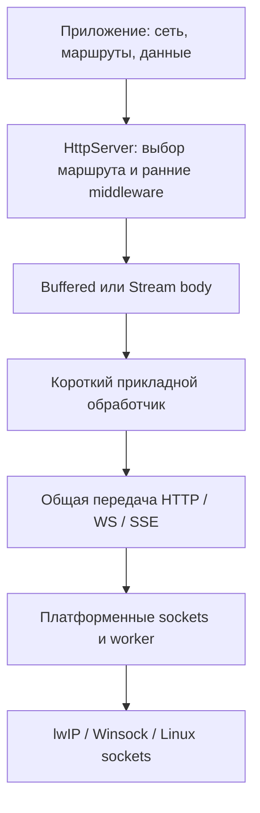
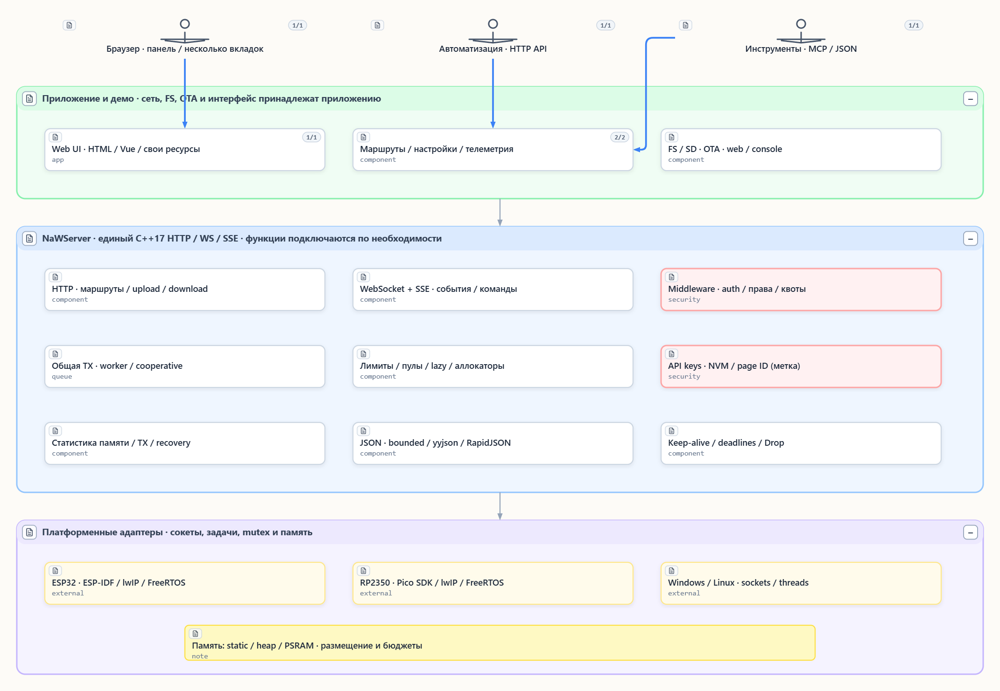
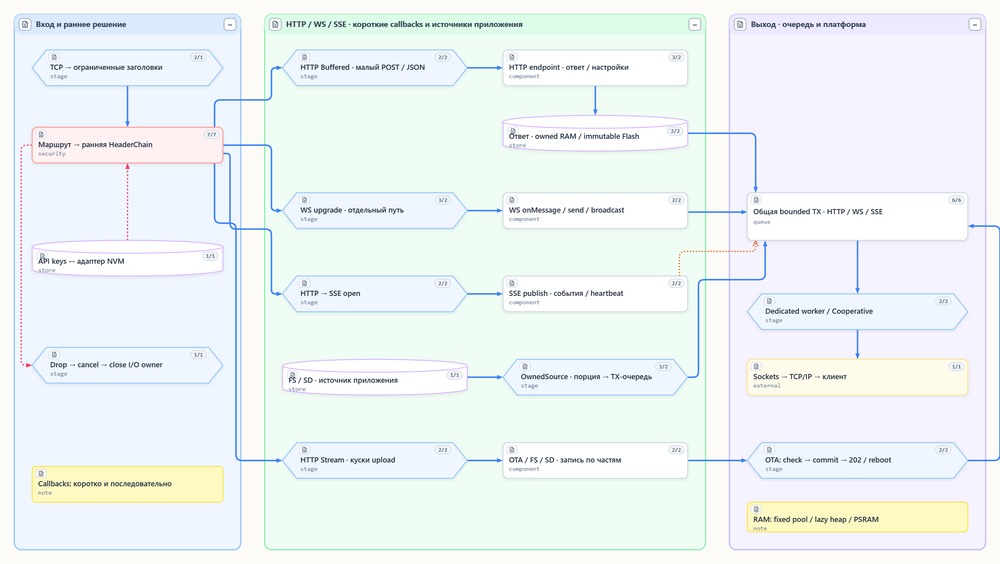

# Архитектура NaWServer: общий сервер и платформенные адаптеры

Актуальный контракт 03.11.2026. Одна реализация HTTP/WS/SSE используется на ESP-IDF,
Pico SDK + FreeRTOS, Windows и Linux. Native ESP-IDF HTTPD и фасад `Server` удалены.

| Уровень | Ответственность |
|---|---|
| Приложение | Wi-Fi/Ethernet, FS/NVM, ключи, таблица маршрутов, короткие callbacks |
| Общий HTTP | Декларативный выбор маршрута, ограниченные заголовки, ранняя цепочка, body mode, терминальный Drop |
| Middleware | Аутентификация, права, идентичность, квоты; функции можно исключить при сборке |
| Управляемые соединения | Ожидание тела/TX без блокировки общего dispatcher, ограниченные рабочие буферы, keep-alive |
| Общая TX | Ограниченная память, очередность передачи, владение payload/source; успешная постановка не означает TCP ACK |
| Платформа | Сокеты, worker, mutex, allocator; никаких таблиц клиентских ключей в TCP |

`HttpServer` получает `TcpHttpBackend`; тот получает реализацию `tcp::Transport`.
Для тестов остаётся `MemoryHttpBackend`. ESP-IDF transport работает через sockets
SDK/lwIP и не заменяет TCP/IP стек. RP использует lwIP sockets и FreeRTOS worker.
TLS пока отсутствует; будущий адаптер должен сохранять общий HTTP-контракт.

Callback приложения последовательный и короткий. Потоковый приём/отдача хранит
ограниченное состояние I/O между вызовами. Это не API произвольного отложенного
HTTP-ответа: долгую прикладную задачу принимают с job-id, результат получают
повторным HTTP-запросом, WS или SSE. Пул таких прикладных задач также ограничен.

Владельцы обработчиков, middleware, policy, транспорта и переданных конфигураций
живут до успешного завершения остановки. Порядок: остановить производителей,
`events.stop()`, `server.end()`, `transport.stop()`. При незавершённой очистке
объекты не уничтожают. `Drop` отменяет ожидающий вывод; native close выполняет
владелец I/O, а не произвольный callback.

- [API HTTP и маршруты](readme_http_api_ru.md)
- [Middleware](readme_middleware_ru.md)
- [Квоты, резерв и расчёт памяти](readme_admission_ru.md)
- [Переносимая сборка](readme_portable_build_ru.md)
- [Потоковое тело и источники ответа](readme_20261103_portable_revision_ru.md)

Авторская модель SeMaps в `docs/diagrams/projects/nawserver` обновлена 06.11.2026:

- `v_capabilities` — текущие возможности, ответственность приложения и платформы;
- `v_data_paths` — пути HTTP Buffered/Stream, RAM/Flash/FS, WS, SSE и прикладной OTA.

Обе карты сохранены через MCP SeMaps; PNG экспортированы из редактора. Это
авторская модель, не результат извлечения C++: extractor не настроен. Первые
шесть карт сохранены с явной пометкой «Архив 28.10». Они и датированные отчёты
описывают свои снимки; их упоминания HTTPD не означают поддержку в текущем коде.
