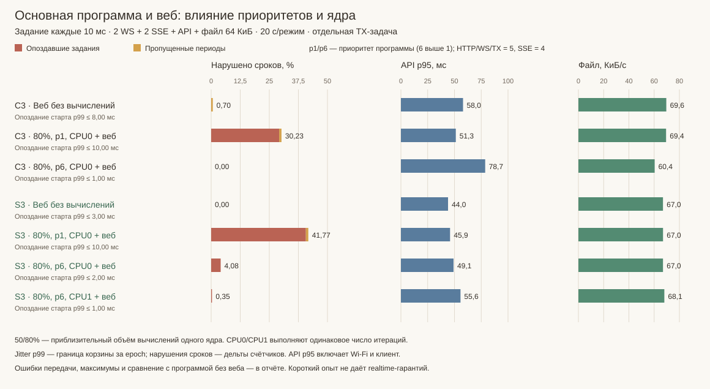

# Основная программа и веб: измерение взаимного влияния

Цель — проверить две вещи одновременно: как нагрузка приложения влияет на веб
и как веб влияет на сроки приложения. Асинхронная архитектура предоставляет
разделение работы и ограниченные очереди; соблюдение сроков проверяется отдельно.

## Стенд

Опциональный `NAWSERVER_DEMO_ASYNC_PROBE` в компактной демо. Ядро библиотеки не
меняется. Основа — `NAWSERVER_DEMO_README_PROFILE=3`, managed HTTP и отдельный TX worker.
В штатной прошивке флаг выключен и тестовые задачи/маршруты отсутствуют.

Основная программа здесь моделируется периодическим вычислительным заданием:
каждые 10 мс задача выполняет фиксированное число арифметических итераций. Количество
калибруется при запуске на 50% или 80% времени одного ядра. Это целевой объём работы,
не ограничитель фактической загрузки: прерывания и конкуренция увеличивают время.
На разных платах калибровка даёт разное число итераций; сравнения влияния веба и
приоритета делают внутри одной платы, а не трактуют таблицу как рейтинг CPU.
Ни одного длительного HTTP callback для создания нагрузки нет.

Для каждого ядра есть задача-пробник с периодическим уведомлением `esp_timer`.
Неактивные пробники только измеряют своевременность пробуждения. Прерывания во время
вычислений включены. На ESP-IDF приоритеты HTTP/WS/TX равны 5, SSE — 4;
у прикладной задачи сравниваются 1 и 6. Это параметры данного backend/стенда,
не универсальные приоритеты всех ОС и SDK. На S3 отдельно меняется ядро приложения;
серверные workers могут планироваться ОС на доступных ядрах.

| Режим | Основная задача | Веб-нагрузка | Что проверяет |
|---|---|---|---|
| Тихий | 0% вычислений | Только начальный/конечный снимки | Цена измерительного стенда |
| Только программа | 80%, приоритет 1 и 6 | Только начальный/конечный снимки | Сроки программы без посетителей |
| Только веб | 0% вычислений | Постоянный обмен | Базовая отзывчивость сервера |
| Программа + веб | 50% и 80%, приоритет 1 | Тот же обмен | Деградация от общего CPU/сети |
| Приоритет программы | 80%, приоритет 6 | Тот же обмен | Обмен своевременностью между задачами |
| Другое ядро S3 | 80%, приоритет 6, CPU1 | Без обмена / тот же обмен | Возможности второго ядра |

Веб-нагрузка: 2 WS с бинарным echo 256 Б дважды в секунду и телеметрией 1/с,
2 SSE по 1/с, HTTP API до 2/с и загрузка immutable-файла 64 КиБ с паузой 250 мс
после завершения. Байты файла проверяются клиентом. Размер и частота одинаковы
между режимами; фактический throughput зависит от времени ответа.

## Показатели

- Программа: число выполненных/пропущенных периодов, незавершение до следующего
  10-мс срока, верхняя граница p99 опоздания старта, максимум опоздания и времени работы.
- Веб: p50/p95/p99 API и WS, максимальная пауза SSE, время/скорость файла, ошибки
  HTTP, отказы WS и SSE publish. Успешная постановка не заменяет проверку получения.
- Ресурсы: средняя занятость CPU и свободная память. Один бинарник на плату,
  режимы переключаются без перезапуска/смены конфигурации сервера.

`late_p99_bound_us` — верхняя граница корзины гистограммы, а не точный квантиль.
`misses` — обработка завершилась позже следующего периода; `skipped` — несколько
уведомлений накопились до запуска и промежуточные периоды не выполнялись.
Оба вида считаются нарушением сроков; нулевые misses при ненулевых skipped не
означают успех. Число циклов/нарушений — дельта начального и конечного снимков с
проверкой epoch. Гистограмма и максимумы относятся ко всей epoch: включая 250 мс
прогрева и получение снимков. Веб-окно — 20 с, запросы на его границе завершаются;
квантили вычисляются после завершения, скорость учитывает время последнего файла.
WS получает отдельные 2 с на завершение echo, остаток отмечается как неполученный.

Калибровка по настенному времени приблизительна и включает прерывания. Для сравнения
CPU0/CPU1 используется **то же число итераций**, откалиброванное на CPU0; повторной
подстройки работы под ядро нет. Отдельно публикуется измеренная суммарная загрузка CPU.

Итоговый срез: ESP-IDF 5.5.6, Release/O3, PSRAM выключена, прошивка
`0.10.1-async-check2`. 16 окон по 20 с на C3/S3. На S3 CPU — среднее по двум ядрам.
Стенд добавляет стек 3072 Б на ядро, измерители и 64 КиБ immutable-данных во Flash;
его память не подменяет расходы обычной прошивки из отдельной серии памяти.

## Результаты

<!-- ASYNC_RESULTS -->

На C3 повышение приоритета программы с 1 до 6 изменило долю нарушенных сроков
с **30,23% до 0,00% в 20-секундном окне**, а API p95 — с **51,3 до 78,7 мс
(+53,5%)**. Так приоритет распределяет отзывчивость между программой и вебом.

| Плата / режим | CPU, % | Периодов | Опоздало / пропущено | Нарушено, % | Старт p99 ≤ / max, мс | API p95, мс | Файл, КиБ/с |
|---|---:|---:|---:|---:|---:|---:|---:|
| C3 · Тихий | 2,0 | 2005 | 0 / 0 | 0,00 | 0,50 / 0,93 | — | — |
| C3 · 80%, p1, CPU0 без веба | 69,0 | 2007 | 3 / 0 | 0,15 | 0,50 / 5,31 | — | — |
| C3 · 80%, p6, CPU0 без веба | 69,5 | 2007 | 0 / 0 | 0,00 | 0,10 / 0,86 | — | — |
| C3 · Веб без вычислений | 19,0 | 2005 | 0 / 14 | 0,70 | 8,00 / 9,84 | 58,0 | 69,6 |
| C3 · 50%, p1, CPU0 + веб | 61,7 | 2006 | 92 / 11 | 5,13 | 8,00 / 9,82 | 42,1 | 69,9 |
| C3 · 80%, p1, CPU0 + веб | 86,8 | 2008 | 587 / 20 | 30,23 | 10,00 / 10,00 | 51,3 | 69,4 |
| C3 · 80%, p6, CPU0 + веб | 85,8 | 2009 | 0 / 0 | 0,00 | 1,00 / 3,06 | 78,7 | 60,4 |
| S3 · Тихий | 1,9 | 2007 | 0 / 0 | 0,00 | 0,20 / 0,82 | — | — |
| S3 · 80%, p1, CPU0 без веба | 38,0 | 2005 | 6 / 0 | 0,30 | 0,50 / 2,54 | — | — |
| S3 · 80%, p6, CPU0 без веба | 38,6 | 2005 | 0 / 0 | 0,00 | 0,50 / 0,83 | — | — |
| S3 · Веб без вычислений | 15,3 | 2006 | 0 / 0 | 0,00 | 3,00 / 5,33 | 44,0 | 67,0 |
| S3 · 50%, p1, CPU0 + веб | 38,3 | 2007 | 70 / 0 | 3,49 | 5,00 / 8,60 | 44,8 | 66,9 |
| S3 · 80%, p1, CPU0 + веб | 52,0 | 2004 | 816 / 21 | 41,77 | 10,00 / 9,99 | 45,9 | 67,0 |
| S3 · 80%, p6, CPU0 + веб | 51,1 | 2008 | 82 / 0 | 4,08 | 2,00 / 4,26 | 49,1 | 67,0 |
| S3 · 80%, p6, CPU1 без веба | 38,9 | 2005 | 0 / 0 | 0,00 | 0,10 / 0,94 | — | — |
| S3 · 80%, p6, CPU1 + веб | 49,7 | 2005 | 7 / 0 | 0,35 | 1,00 / 1,79 | 55,6 | 68,1 |

| Плата / режим с вебом | API OK / ошибки | Файлы OK / ошибки | WS получено / отправлено | SSE событий | SSE max пауза, с |
|---|---:|---:|---:|---|---:|
| C3 · Веб без вычислений | 38 / 0 | 22 / 0 | 80 / 80 | 19 / 19 | 1,03 |
| C3 · 50%, p1, CPU0 + веб | 38 / 0 | 22 / 0 | 80 / 80 | 20 / 20 | 1,02 |
| C3 · 80%, p1, CPU0 + веб | 38 / 0 | 22 / 0 | 80 / 80 | 20 / 20 | 1,02 |
| C3 · 80%, p6, CPU0 + веб | 36 / 0 | 19 / 0 | 80 / 80 | 20 / 20 | 1,10 |
| S3 · Веб без вычислений | 38 / 0 | 21 / 0 | 80 / 80 | 20 / 20 | 1,01 |
| S3 · 50%, p1, CPU0 + веб | 38 / 0 | 21 / 0 | 80 / 80 | 20 / 20 | 1,02 |
| S3 · 80%, p1, CPU0 + веб | 38 / 0 | 21 / 0 | 80 / 80 | 20 / 20 | 1,02 |
| S3 · 80%, p6, CPU0 + веб | 38 / 0 | 21 / 0 | 80 / 80 | 20 / 20 | 1,02 |
| S3 · 80%, p6, CPU1 + веб | 38 / 0 | 22 / 0 | 80 / 80 | 20 / 20 | 1,01 |

<!-- /ASYNC_RESULTS -->

Во всех нагрузочных окнах: HTTP API и файлы без ошибок, WS — по 80/80 echo,
без неверных/неполученных сообщений после дренирования. SSE — по 19–20 событий
за окно, без ошибок/отказов/истечений publish. Граница окна не гарантирует ровно
20 событий от независимого 1-Гц производителя.

На S3 для высокоприоритетной программы перенос CPU0→CPU1 уменьшил нарушения сроков
**4,08% → 0,35%**; API p95 изменился **49,1 → 55,6 мс (+13,2%)**. Без веб-нагрузки
у этих приоритетных задач нарушений в измерительном окне не было.

У C3 high-priority `afterProbe.misses=1`, но этот же счётчик равен 1 уже в `beforeProbe`:
в 250-мс прогреве был один выход за срок, в измерительном окне — 0. Максимумы и
гистограмма включают прогрев, поэтому их scope отличается от дельт в таблице.

После опытов обе платы возвращены на `0.8.1-tx-execution`; существующие name,
interval и LED сохранены. Переписывался только неактивный слот приложения:
разметка, FS и NVS не перепрошивались.

## Как читать результат

Небольшое изменение задержек при сохранении сроков показывает пригодность **данного
сочетания** задач и нагрузки. Рост jitter/отказов показывает границу, даже если CPU
не достигает 100%. Повышение приоритета программы может улучшить её сроки и ухудшить
веб; приоритет TX влияет на выбор данных, приоритет ОС — на выдачу CPU. Это разные
механизмы. Долгий callback, ISR, flash erase и взаимные блокировки требуют отдельных
сценариев; синтетические вычисления не проверяют их автоматически.

Исходник: [async_probe.hpp](../examples/compact/esp/main/async_probe.hpp),
интеграция — [readme_profile.hpp](../examples/compact/esp/main/readme_profile.hpp).
`/probe/config?mode=0..4` переключает режим, `/probe/state` отдаёт счётчики,
`/probe/file` — проверяемый immutable-ресурс. Эти публичные диагностические маршруты
существуют только в специальной тестовой сборке.

[Обезличенные результаты](../examples/compact/ASYNC_RESULTS.json) ·
[Клиент нагрузочного теста, Node.js с native WebSocket](../examples/compact/tests/async_workload.mjs) ·
[Генератор графиков/таблиц](../examples/compact/tests/async_report.mjs).
Генератор запускается из корня: `node examples/compact/tests/async_report.mjs`.
Клиент только измеряет явно указанный стенд; сам не прошивает и не создаёт ключей.
