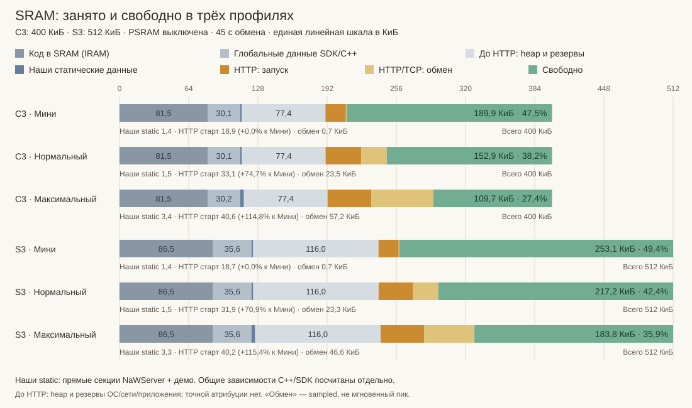
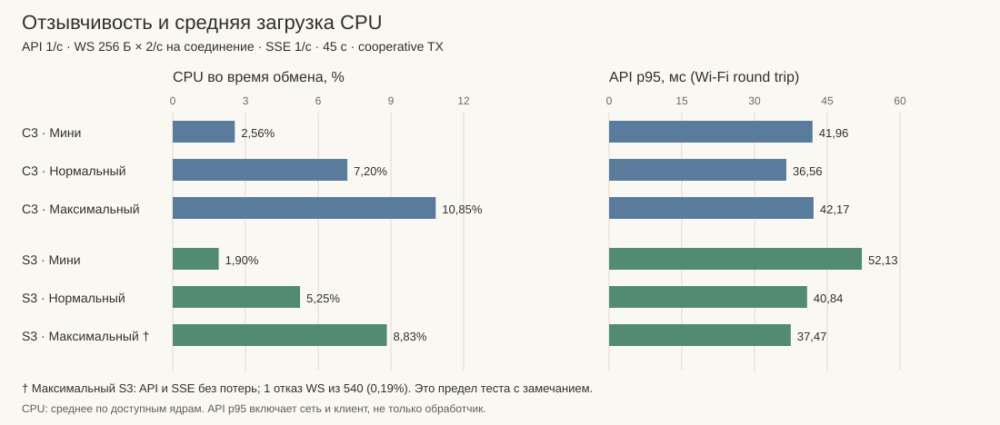

# Три профиля NaWServer: C3 и S3, 06.11.2026

Короткое сравнение конфигураций, опубликованное в корневых README. Это отдельный
стенд соединений, а не измерение трёх вариантов полноценного браузерного frontend.
RP в этой серии не перепрошивался; старые результаты не выдаются за новые.

## Условия и воспроизведение

- ESP-IDF 5.5.6, Release/O3, PSRAM выключена; Wi-Fi и сохранённые настройки общие.
- C3: 400 КиБ физической SRAM, S3: 512 КиБ. CPU S3 нормирован на оба ядра:
  100% означает полную занятость суммарной доступной вычислительной мощности.
- Один HTTP API-клиент с сохранённым ключом, опрос 1/с. Ключ не создаётся/не меняется.
- «Страница» моделируется отдельным WS: бинарный echo 256 Б дважды в секунду,
  плюс текстовая телеметрия раз в секунду. SSE — также раз в секунду.
- HTML всего 408 Б; при наличии страниц его запрашивают раз в 2 с.
  Это не Vue-панель и не тест стоимости рендеринга/больших ресурсов сайта.
- Сначала 12 с без внешних клиентов, затем окно обмена 45 с. До старта берётся
  UART-снимок heap, после запуска — снимок через примерно секунду стабилизации.
  CPU усредняется по разнице накопительных busy/sample счётчиков.
- Во всех профилях cooperative TX. AUTH, клиентские квоты и MCP выключены;
  сервис ключей и потоковый OTA для возврата обычной прошивки остаются включёнными.

Профиль задаёт `NAWSERVER_DEMO_README_PROFILE=1/2/3`, обычное демо — 0.
Дополнительный `NAWSERVER_DEMO_MEMORY_PROFILE=readme` фиксирует одинаковые
SDK-настройки: 16 сокетов lwIP, TCP window/send 2880 Б, Wi-Fi RX static4/dynamic8,
TX dynamic8. Стек main и HTTP — по 8192 Б. Пример сборки:

```powershell
./examples/compact/esp/Build.ps1 -Target esp32c3 `
  -NAWSERVER_DEMO_MEMORY_PROFILE readme -NAWSERVER_DEMO_README_PROFILE 2 `
  -NAWSERVER_DEMO_MAIN_STACK 8192 -Version 0.9.0-profile2
```

Операции OTA идентифицировали целевые платы и меняли только неактивный app slot.
После серии на обе платы возвращена `0.8.1-tx-execution`; сохранённые name/interval/LED
сравнены, FS/NVS и разметка не заменялись. OTA здесь проверяет установку/возврат,
а не работу шести вкладок во время прошивки.

## Конфигурации

| Параметр | Мини / 1 | Нормальный / 2 | Максимальный / 3 |
|---|---:|---:|---:|
| API / WS / SSE | 1 / 0 / 0 | 1 / 3 / 0 | 1 / 6 / 4 |
| TCP-соединения сервера | 2 | 6 | 13 |
| Managed HTTP initial / max | 1 / 1 | 1 / 3 | 1 / 3 |
| Ingress | 1 | 3 | 3 |
| Header / response workspace, Б | 1024 / 1024 | 1024 / 1024 | 1024 / 1024 |
| WS arena на клиента, Б | — | 4096 | 4096 |
| WS max message / pending / pending bytes | — | 256 / 2 / 1024 | 256 / 2 / 1024 |
| TX блок / max блоков / потолок payload, Б | 1024 / 2 / 2048 | 1024 / 13 / 13312 | 1024 / 22 / 22528 |
| TX на соединение / important reserve, блоков | 2 / 0 | 2 / 0 | 2 / 0 |
| SSE clients / pending / bytes per client | — | — | 4 / 1 / 128 |

Бюджет — потолок, а не обязательно выделенная при старте память. При отключении
WS/SSE соответствующий код исключается конфигурацией сборки. Большие upload
принимаются отдельным Stream-маршрутом; обычные bodies ограничены 256 Б.

## Память до, после запуска и при обмене



Для всех строк используется одна линейная шкала байтов от нуля. Полная полоса C3
(400 КиБ) занимает 78,125% длины полосы S3 (512 КиБ); каждый сегмент масштабируется
тем же коэффициентом пикселей на байт, без минимальной визуальной ширины.
Проценты свободной памяти в подписях рассчитаны от SRAM соответствующей платы.

<!-- EXACT_MEMORY_TABLE -->

| Плата / профиль | Heap до, Б | После, Б | Цена старта, Б / % SRAM | Min free, Б / % SRAM | Min largest, Б |
|---|---:|---:|---:|---:|---:|
| C3 / 1 | 214 596 | 195 224 | 19 372 / 4,73% | 194 472 / 47,48% | 114 688 |
| C3 / 2 | 214 444 | 180 596 | 33 848 / 8,26% | 156 524 / 38,21% | 114 688 |
| C3 / 3 | 212 596 | 170 984 | 41 612 / 10,16% | 112 368 / 27,43% | 94 208 |
| S3 / 1 | 279 008 | 259 900 | 19 108 / 3,64% | 259 152 / 49,43% | 212 992 |
| S3 / 2 | 278 900 | 246 240 | 32 660 / 6,23% | 222 380 / 42,42% | 172 032 |
| S3 / 3 | 277 056 | 235 888 | 41 168 / 7,85% | 188 208 / 35,90% | 135 168 |

<!-- /EXACT_MEMORY_TABLE -->

`Heap до` уже учитывает всю прошивку, статические transport/backend/Fixture и
предшествующий запуск SDK/Wi-Fi. Поэтому «старт» — **дополнительный динамический
расход**, не полная цена наличия библиотеки. Статические объекты повторно не
прибавляются.

### Куда ушли 190 КиБ до HTTP

Серый блок разделён по ELF/map **тех же шести прошивок**: версия ELF проверена
против версии замера. Ниже пример двух минимальных профилей; единицы — КиБ / %
физической SRAM соответствующей платы.

<!-- BASELINE_BREAKDOWN -->

| Часть | C3 Мини: КиБ / % SRAM | S3 Мини: КиБ / % SRAM |
|---|---:|---:|
| Код в SRAM (IRAM) | 81,5 / 20,38% | 86,5 / 16,89% |
| Глобальные данные SDK/C++ | 30,1 / 7,54% | 35,6 / 6,95% |
| Наши прямые статические данные | 1,4 / 0,36% | 1,4 / 0,28% |
| Heap и резервы до HTTP, без точной атрибуции | 77,4 / 19,34% | 116,0 / 22,66% |
| Итого до HTTP | 190,4 / 47,61% | 239,5 / 46,78% |
| Дополнительно при запуске HTTP | 18,9 / 4,73% | 18,7 / 3,64% |

<!-- /BASELINE_BREAKDOWN -->

Код IRAM — инструкции, действительно размещённые в SRAM, а не весь машинный код
прошивки. Глобальные данные — DRAM data/bss; прямые секции архивов NaWServer и main
выделены отдельно. В «наши static» входят и статические владельцы backend/Fixture.
Остальное включает SDK/C++, в том числе транзитивные зависимости нашего приложения.
Поэтому 1,4 КиБ — **не вся цена наличия NaWServer** и не сравнение с прошивкой без него.

`Heap и резервы до HTTP` — остаток после вычитания resident-кода и данных из
`физическая SRAM − heap до`. Это смесь ОС/сети, уже созданных прикладных хранилищ,
служебных расходов allocator и областей вне свободного internal/8bit heap. По одному
снимку нельзя честно подписать весь остаток «Wi-Fi» или «FreeRTOS».
Для их отдельной атрибуции нужны снимки этапов SDK/NVS/сети либо трасса выделений.

Разбор использует `objdump -h`, символы и archive contributions в map. Суммируются
IRAM text/vectors/text_end и DRAM data/bss/noinit; `.dram0.dummy` — алиас IRAM и
повторно не прибавляется. RTC — отдельная память, здесь не прибавляется;
байты Flash также не прибавляются к занятой SRAM.

Для масштаба: в C3 Мини из 81,5 КиБ IRAM прямые map-вклады кода FreeRTOS — 14,7 КиБ,
драйвера Flash — 9,8 КиБ, allocator heap — 8,1 КиБ, HAL — 7,7 КиБ. Это **код в SRAM**,
а не размеры стеков, файлов или выделенных этими подсистемами буферов.

### Копируется ли сайт в ОЗУ

**Полная страница не копируется в RAM.** В ELF обычной компактной прошивки
`0.8.1-tx-execution` обеих плат символ `compact_web::gzip` размером 7 773 Б находится
в `.flash.rodata`. Генератор создаёт `inline constexpr` массив; обработчик
`common/demo.cpp` отдаёт его через `Response::sendImmutable()`. В измерительном ELF
HTML также находится во Flash: 409 Б с завершающим нулём, 408 Б передаются клиенту.

Managed HTTP при immutable-ответе сохраняет view, а не выделяет `output_body` с копией.
Общая TX сохраняет адрес immutable-фрагмента; копии всего сайта в её payload нет.
lwIP/Wi-Fi могут копировать передаваемые порции в свои ограниченные буферы — это
отдельный расход передачи. Gzip распаковывает браузер, не микроконтроллер.
Полный ESP Showcase также использует `sendImmutable`; RP читает LittleFS ограниченными
порциями через owned source, а Flash fallback отдаёт immutable. Это не обещание
нулевых копий в сетевом стеке или отсутствия буферов при чтении FS.

`Обмен` на графике = heap после старта − минимум sampled free heap. Выборки берутся
при HTTP-опросе; между ними возможны меньшие значения. Это не трассированный пик,
не счётчик всех malloc и не исключительно расходы NaWServer: сюда входят TCP/Wi-Fi.
Largest block также sampled: достаточная сумма свободной памяти не гарантирует
возможность одного большого выделения.

## Отзывчивость и качество



<!-- EXACT_LOAD_TABLE -->

| Плата / профиль | CPU простой / обмен, % | API OK / ошибки | API p95, мс | WS echo / попытки | SSE событий по клиентам | Результат |
|---|---:|---:|---:|---:|---|---|
| C3 / 1 | 1,42 / 2,56 | 44 / 0 | 41,96 | — | — | OK |
| C3 / 2 | 1,58 / 7,20 | 44 / 0 | 36,56 | 267 / 267 | — | OK |
| C3 / 3 | 1,69 / 10,85 | 44 / 0 | 42,17 | 540 / 540 | 46 / 46 / 46 / 46 | OK |
| S3 / 1 | 1,11 / 1,90 | 44 / 0 | 52,13 | — | — | OK |
| S3 / 2 | 1,16 / 5,25 | 44 / 0 | 40,84 | 270 / 270 | — | OK |
| S3 / 3 | 1,28 / 8,83 | 44 / 0 | 37,47 | 539 / 540 | 46 / 46 / 46 / 46 | 1 отказ WS |

<!-- /EXACT_LOAD_TABLE -->

HTTP API p95 — полное время запроса по Wi-Fi с клиентской стороны. Разница в
несколько миллисекунд не отделяет сервер от условий радио/планировщика. За 45 с
получено по 44 API-ответа: следующий запрос начинается через секунду **после**
предыдущего ответа, поэтому это не ровно 45 запросов.

На максимальном S3 зафиксирован один отказ `send_binary` из 540 попыток (0,19%):
539 echo вместо 540. Строгий результат отмечен с замечанием, хотя первоначальный
runner допускал одно незавершённое echo и печатал `pass=true`. Нулевые `tx_failed`
учитывают уже принятые TX jobs и не отменяют отказ до постановки. Причина WS-отказа
этими счётчиками не локализована; отсутствие ошибок API не доказывает надёжность WS.

### Что исправлено в SSE-производителе стенда

В первом максимальном опыте `0.9.1-profile3` callback учитывал только `Queued` и
пропускал остальные результаты `publish()`: S3 получил 46/44/37/35 событий,
пауза до 3,02 с. `QueuedAdapter::publish()` может немедленно вернуть `Busy` при
занятом mutex или неготовности direct stream к записи, включая передачу заголовков.
Это не подтверждение публикации и не универсальное обозначение переполнения очереди.

В `0.9.2-profile3` добавлен **один pending bit на подписчика и общий timestamp**.
`Busy` повторяется на следующих 10-мс тиках до следующего периода; нет новой
неограниченной очереди и нет цикла ожидания внутри callback. Все остальные
результаты и истечение периода считаются отдельно. На S3 было 18 повторов Busy,
0 прочих отказов/истечений; все четыре клиента получили по 46 событий. У C3 Busy=0.
Максимальная пауза всё равно достигала 1,73 с у C3 / 1,66 с у S3. Это улучшение
прикладного производителя; изменения ядра библиотеки не потребовались.

Мини/нормальный измерены на `0.9.0`, максимальный — на `0.9.2` с этими счётчиками
и ограниченным повтором. Условия и лимиты транспорта одинаковы по описанному профилю,
но это не сравнение побайтно одинаковых BIN. Некорректная начальная попытка с шестью
SSE исключена: предел текущего `EventSource` равен четырём, его start закономерно отказал.

## Что остаётся для приложения / LVGL

Максимальная C3 сохраняет sampled free 109,7 КиБ, largest 92 КиБ; S3 — 183,8 КиБ,
largest 132 КиБ, без PSRAM. Нормальные профили оставляют больше — см. таблицу.
Чистая арифметика RGB565: кадр 240×240 требует 115 200 Б (112,5 КиБ), два —
230 400 Б (225 КиБ); два буфера по 20 строк — 19 200 Б (18,75 КиБ). Это только пиксели:
объекты GUI, шрифты, стеки, DMA-ограничения и запас сети считаются сверх этого.
Следовательно, полный двойной framebuffer нельзя обещать по одной цифре free heap.
Отдельные [расчёты LVGL](../examples/compact/MEMORY_LVGL_RU.md) и
[эксперименты RAM/PSRAM S3](../examples/compact/PSRAM_PLACEMENT_MEASUREMENTS_RU.md)
описывают другие конфигурации, не новые числа этой серии.

## Исходные данные

- [Обезличенные наблюдения, байты и счётчики](../examples/compact/README_PROFILE_RESULTS.json).
- [Сам стенд](../examples/compact/esp/main/readme_profile.hpp),
  [конфигурация](../examples/compact/esp/sdkconfig.readme.defaults).
- [Генератор SVG и синхронных таблиц README](../examples/compact/tests/readme_report.mjs):
  `node examples/compact/tests/readme_report.mjs` из корня.
- [Отдельный matched HTTPD / простой HTTP / managed / TX разбор](../examples/compact/MEMORY_BRICKS_RU.md).

Сырые serial/сетевые журналы и BIN остаются в игнорируемом локальном каталоге,
ключи и адреса стенда в публичный набор данных не включены.
