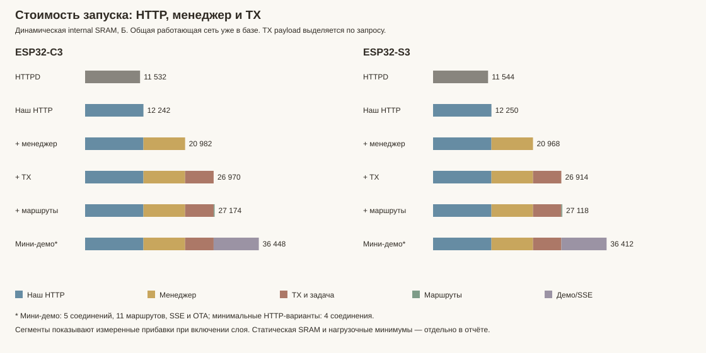

# Из чего складывается память HTTP и TX на C3 и S3

Измерения 06.11.2026. Главный вывод: простой наш HTTP близок к системному HTTPD. Основную прибавку дают **менеджер HTTP и его заранее подготовленные рабочие места**, затем **TX с отдельной задачей**. Данные самой TX-очереди в этом опыте выделяются по запросу; постоянные метаданные очереди занимают 848 Б.

## Расход памяти: выделенный TX-поток и кооперативный рядом

Добавочный **динамический расход** относительно состояния до создания backend. Он включает объекты демо, HTTP/SSE/TX и возникающие при обмене расходы lwIP/Wi-Fi. Статические data/bss/IRAM сюда не входят и рассмотрены отдельно. Проценты в скобках — от физической SRAM: C3 409600 Б, S3 524288 Б. Разница считается относительно выделенного потока; минус означает меньший расход кооперативного режима.

| Плата / этап | Выделенный TX-поток, Б (% SRAM) | Кооперативный, Б (% SRAM) | Изменение расхода, Б / % |
|---|---:|---:|---:|
| C3 / После запуска | 39 324 (9,60%) | 34 840 (8,51%) | -4 484 / -11,40% |
| C3 / Обычный обмен: две SSE + API + страница | 47 892 (11,69%) | 42 064 (10,27%) | -5 828 / -12,17% |
| C3 / Частые запросы + две SSE | 48 780 (11,91%) | 46 528 (11,36%) | -2 252 / -4,62% |
| C3 / Приостановлен один читатель | 46 792 (11,42%) | 41 664 (10,17%) | -5 128 / -10,96% |
| C3 / Во время OTA с API/SSE | 50 268 (12,27%) | 44 068 (10,76%) | -6 200 / -12,33% |
| S3 / После запуска | 39 140 (7,47%) | 34 656 (6,61%) | -4 484 / -11,46% |
| S3 / Обычный обмен: две SSE + API + страница | 42 520 (8,11%) | 36 308 (6,93%) | -6 212 / -14,61% |
| S3 / Частые запросы + две SSE | 44 968 (8,58%) | 46 384 (8,85%) | +1 416 / +3,15% |
| S3 / Приостановлен один читатель | 48 440 (9,24%) | 40 848 (7,79%) | -7 592 / -15,67% |
| S3 / Во время OTA с API/SSE | 48 596 (9,27%) | 43 180 (8,24%) | -5 416 / -11,14% |

Статическая память соответствующих прошивок **одинакова в двух режимах**: по ELF у C3 data 12324 Б + bss 18872 Б + IRAM 88576 Б = **119772 Б (29,24% SRAM)**; у S3 data 19492 Б + bss 17272 Б + IRAM 92928 Б = **129692 Б (24,74% SRAM)**. Это секции всей прошивки, включая SDK; они не включены в добавочную динамику таблицы. Стек TX на ESP выделяется из heap и уже входит в динамический расход.

После запуска получена одинаковая экономия **4484 Б** на каждой плате — примерно **11,4% динамической цены старта**. Во время обмена показан наибольший расход среди снятых образцов, не гарантированный мгновенный пик. У S3 в частом обмене кооперативный вариант в этом прогоне потреблял на 1416 Б больше: он успевал обработать больше запросов/страниц. Постоянная экономия отдельного стека не гарантирует меньшего максимального расхода всего обмена.

## Условия и границы

ESP-IDF 5.5.6, Release с CONFIG_COMPILER_OPTIMIZATION_PERF=y, общий уже подключённый Wi-Fi/lwIP, PSRAM выключена на обеих платах. HTTPD и наш минимальный HTTP: 4 соединения, стек HTTP 8192 Б, один GET /benchmark с телом OK. В managed-вариантах 2 входных места, максимум 3 HTTP-задания, 1 начальный набор буферов. TX: 3 блока по 1024 Б, ленивое выделение payload, без важного резерва. WS выключен. Полное демо имеет 5 соединений, 11 маршрутов, ключ API, два SSE и OTA, поэтому его строка — дополнительный прикладной профиль.

Динамические расходы измерены в **одном ELF** последовательно, два цикла без heap tracing; места выделений определены отдельным трассировочным ELF. Это сравнение прогретых запусков. Полное демо запускалось после минимальных вариантов, а не с холодного сброса. Сама платформа с настройками/ключами и Wi-Fi уже существуют в базовом снимке. Статическая память отдельно проверена пятью самостоятельными компоновками ELF. Они не прошивались.

## Динамическая стоимость запуска

Сумма неперекрывающихся этапов создания транспорта, backend и запуска. Для первых трёх вариантов исключены неиспользуемые тестовые Route/HttpServer. SDK-монитор минимума сам временно выделял 20–28 Б: таблица пересчитана по следующим снимкам после его освобождения. Это убирает систематическое повторное включение монитора; остаются обычные колебания фонового SDK в десятки байт. Процент разницы — относительно HTTPD той же платы.

| Вариант | C3, Б (2 запуска) | C3: к HTTPD | C3: % 400 КиБ SRAM | S3, Б (2 запуска) | S3: к HTTPD | S3: % 512 КиБ SRAM |
|---|---:|---:|---:|---:|---:|---:|
| ESP-IDF HTTPD | 11 532 | 0 / 0,00% | 2,82% | 11 544 | 0 / 0,00% | 2,20% |
| Наш простой HTTP | 12 240–12 244 | 710 / 6,16% | 2,99% | 12 248–12 252 | 706 / 6,12% | 2,34% |
| + менеджер HTTP | 20 976–20 988 | 9 450 / 81,95% | 5,12% | 20 964–20 972 | 9 424 / 81,64% | 4,00% |
| + TX-очередь и задача | 26 952–26 988 | 15 438 / 133,87% | 6,58% | 26 908–26 920 | 15 370 / 133,14% | 5,13% |
| + один Route / HttpServer | 27 156–27 192 | 15 642 / 135,64% | 6,63% | 27 112–27 124 | 15 574 / 134,91% | 5,17% |
| Полное мини-демо (5 соединений) | 36 448 | 24 916 / 216,06% | 8,90% | 36 412 | 24 868 / 215,42% | 6,95% |

| Откуда прибавка к HTTPD | C3, Б | Доля разницы C3 | S3, Б | Доля разницы S3 |
|---|---:|---:|---:|---:|
| Разница простых HTTP-движков | 710 | 4,60% | 706 | 4,59% |
| Менеджер HTTP | 8 740 | 56,61% | 8 718 | 56,72% |
| TX с отдельной задачей | 5 988 | 38,79% | 5 946 | 38,69% |

## Постоянные составляющие нашего managed HTTP + TX

Запрошенные размеры живых выделений подтверждены heap trace и символами ELF. Это запрошенные байты, а не размер физического блока с накладными расходами allocator. Числа относятся к исходной серии с отдельной TX-задачей до добавления выбора исполнителя.

| Составляющая | C3, Б | S3, Б | Зачем / зависимость от настройки |
|---|---:|---:|---|
| HTTP: стек + TCB | 8 544 | 8 552 | 8192 Б стека + 352/360 Б TCB; стек выделен целиком, watermark показывает только его использование |
| TX: стек + TCB | 4 448 | 4 456 | 4096 Б стека; расход появляется из-за задачи, а не самого факта наличия очереди |
| Два ingress-набора + таблица Input | 4 288 | 4 288 | 2 × (1024 Б текста заголовков + 384 Б записей + 512 Б раннего ответа) + 448 Б состояния |
| Один начальный набор HTTP-буферов | 2 944 | 2 944 | 1920 Б: заголовки + записи + заголовок ответа; 1024 Б: копируемое тело ответа |
| Таблицы заданий, связей и слотов пулов | 1 665 | 1 665 | 1104 Б Job, 256 Б StreamLink, 1 Б Client, 108 Б слотов пулов, 176 Б реестра/закрытия, 20 Б readiness |
| Метаданные TX | 848 | 848 | 8 записей handles и 3 задания, включая выравнивание; payload сюда не входит |
| Объекты транспорта, backend, runtime, manager, TX и ledger | 2 272 | 2 272 | 12 + 348 + 536 + 832 + 488 + 56 Б; это размеры объектов, а не их дочерних буферов |
| 11 инициализированных mutex | 1 100 | 1 100 | На один 8 Б pthread-обёртки + 92 Б FreeRTOS; накладные расходы кучи отдельно |
| Две служебные Worker-обёртки | 32 | 32 | По 16 Б |
| Сумма перечисленного | 26 141 | 26 157 | Без сетевых служебных выделений и накладных расходов allocator |

C3: до измеренного общего расхода 26 970 Б остаётся 829 Б — сетевые служебные структуры, TLS/семафоры lwIP, выравнивание/учёт allocator и фоновое колебание. Они не названы payload очереди.

S3: до измеренного общего расхода 26 914 Б остаётся 757 Б — сетевые служебные структуры, TLS/семафоры lwIP, выравнивание/учёт allocator и фоновое колебание. Они не названы payload очереди.

У HTTPD стек/TCB составляют те же примерно 8,5 КБ. Его основные стартовые структуры в трассе — 784 и 768 Б, плюс URI и сетевые/управляющие сокеты. Отдельной TX-задачи в тесте нет. Системный HTTPD динамически подготавливает scratch для разбора конкретного запроса; наш managed-режим заранее сохраняет несколько рабочих мест. Поэтому экономия его простоя частично оплачивается последующим динамическим расходом.

## Статическая SRAM и Flash: отдельные компоновки

Одинаковые SDK-настройки, main stack 8192 Б, tracing выключен. Сначала сеть без HTTP, затем HTTPD, наш простой HTTP, managed + TX, полное демо. Учтены DRAM data/bss и IRAM с векторами/выравниванием. .dram0.dummy — алиас занятой IRAM, второй раз не прибавляется. RTC 56 Б одинаковы и в сумму SRAM ниже не включены.

| Плата / ELF | DRAM data, Б | BSS, Б | IRAM, Б | SRAM всего / % физической | Прибавка к сети | Разница SRAM с HTTPD | Отображаемые секции Flash, Б |
|---|---:|---:|---:|---:|---:|---:|---:|
| C3 / Сеть | 12 276 | 17 552 | 82 432 | 112 260 / 27,41% | 0 | -512 / -0,45% | 678 562 |
| C3 / HTTPD | 12 276 | 17 552 | 82 944 | 112 772 / 27,53% | 512 | 0 / 0,00% | 729 240 |
| C3 / Наш простой HTTP | 12 316 | 18 728 | 82 944 | 113 988 / 27,83% | 1 728 | 1 216 / 1,08% | 770 152 |
| C3 / Managed + TX | 12 316 | 18 728 | 82 944 | 113 988 / 27,83% | 1 728 | 1 216 / 1,08% | 770 152 |
| C3 / Полное демо | 12 324 | 18 856 | 88 576 | 119 756 / 29,24% | 7 496 | 6 984 / 6,19% | 870 872 |
| S3 / Сеть | 19 428 | 15 952 | 87 808 | 123 188 / 23,50% | 0 | -256 / -0,21% | 611 148 |
| S3 / HTTPD | 19 428 | 15 952 | 88 064 | 123 444 / 23,55% | 256 | 0 / 0,00% | 653 484 |
| S3 / Наш простой HTTP | 19 508 | 17 112 | 88 064 | 124 684 / 23,78% | 1 496 | 1 240 / 1,00% | 689 652 |
| S3 / Managed + TX | 19 508 | 17 112 | 88 064 | 124 684 / 23,78% | 1 496 | 1 240 / 1,00% | 689 652 |
| S3 / Полное демо | 19 492 | 17 248 | 92 672 | 129 412 / 24,68% | 6 224 | 5 968 / 4,83% | 784 892 |

В этих компоновках включение managed/TX меняет runtime-настройку, поэтому простая и managed/TX сборки имеют одинаковый размер секций: код обоих путей уже присутствует. Это не обещание, что все отключаемые возможности всегда удаляются linker. Значение Flash в таблице — сумма .flash.text/.rodata/.appdesc/.init_array/.tdata; оно не включает загрузочные копии IRAM/DRAM и не равно полному размеру BIN.

**Статическую и динамическую таблицы нельзя механически складывать:** в отдельных ELF transport/backend имеют static ownership, а в runtime-стенде они созданы через new. Без поправки на размещение одни и те же объекты были бы посчитаны дважды. Архив NaWServer в общем диагностическом ELF непосредственно даёт 20 Б data и 8 Б bss; transitive C++/SDK-зависимости отражает именно сравнение полных компоновок, а не эти 28 Б.

## Во время обмена

Ниже дополнительное снижение свободной internal/8bit памяти относительно начала окна. Это **консервативная огибающая минимума**: IDF складывает минимумы отдельных heap-регионов, которые могли достигаться в разное время. Величины включают 20–28 Б рабочего места монитора. Это не точный одновременно живой пик и не сумма всех malloc за окно. Проценты сравнивают верхнюю границу двух прогонов с HTTPD в том же сценарии.

| Вариант | C3: один GET, Б | C3: 2 клиента, Б | S3: один GET, Б | S3: 2 клиента, Б |
|---|---:|---:|---:|---:|
| ESP-IDF HTTPD | 5 348 (0,00%) | 10 672–10 680 (0,00%) | 5 328–5 332 (0,00%) | 10 660–10 672 (0,00%) |
| Наш простой HTTP | 10 152–13 628 (154,82%) | 14 140–17 716 (65,88%) | 10 088–10 124 (89,87%) | 15 768–15 776 (47,83%) |
| + менеджер HTTP | 7 156 (33,81%) | 16 232–16 240 (52,06%) | 5 332–7 116 (33,46%) | 16 160–16 168 (51,50%) |
| + TX-очередь и задача | 5 552–7 324 (36,95%) | 11 108–11 288 (5,69%) | 7 272–7 276 (36,46%) | 11 208–16 156 (51,39%) |
| + один Route / HttpServer | 5 540–7 324 (36,95%) | 11 116–16 212 (51,80%) | 5 488–7 276 (36,46%) | 11 436–16 148 (51,31%) |

Два клиента здесь — по 8 последовательных GET каждый. Без tracing все 16 запросов каждого окна получили 200. В отдельном сценарии два незавершённых заголовка занимают оба managed ingress-места: третий GET получает reset; это проверка конечной ёмкости, а не равной успешной пропускной способности. HTTPD и простой наш путь дождались освобождения клиента и ответили.

Наивное отключение managed/TX уменьшает расход простоя, но у простого нашего HTTP временная огибающая выше HTTPD. Трассировка одного GET обнаруживает сетевые выделения по 1532 Б (pbuf) и 1700 Б (динамический Wi-Fi буфер). Размер ответа 2 Б не равен стоимости передачи: lwIP и Wi-Fi хранят свои данные, пакеты, подтверждения/повторы. Наш прямой ResponseWriter передаёт отдельные фрагменты заголовков; объединение мелких send — кандидат для отдельного эксперимента, причинный эффект здесь не измерен.

## Полное демо: запуск, SSE, API/страница и OTA

Полное демо имеет 5 соединений. API 1 клиент, две SSE, параллельные запросы страницы. Для OTA потоки завершены до загрузки, поэтому этот конкретный опыт измеряет OTA отдельно; совместную нагрузку покрывают предыдущие отчёты и сравнение исполнителей ниже.

| Этап / величина | C3 | S3 |
|---|---:|---:|
| Создание transport | 28 Б | 16 Б |
| Создание backend | 468 Б | 468 Б |
| Создание объектов демо/маршрутов/SSE | 4 820 Б | 4 704 Б |
| Запуск HTTP + TX + SSE | 31 132 Б | 31 224 Б |
| Всего запуска | 36 448 Б | 36 412 Б |
| Один запрос статуса: дополнительный минимум | 8 028 Б | 7 236 Б |
| Две SSE: дополнительный минимум окна | 8 096 Б | 8 024 Б |
| Две SSE + API и страница: дополнительный минимум | 11 176 Б | 20 680 Б |
| OTA: дополнительный минимум окна | 8 128 Б | 8 948 Б |
| OTA: минимальная непосредственно снятая свободная куча | 166 088 Б | 231 956 Б |
| OTA: минимальный свободный непрерывный блок | 114 688 Б | 188 416 Б |

Свободная память после запуска — примерно 171 912 Б (41,97% физической C3) и 237 384 Б (45,28% S3) **в общем диагностическом ELF**. Это не остаток обычной установленной прошивки: ELF также содержит HTTPD и диагностический код.

## Численные снимки разных областей памяти

Контрольная серия без tracing. Это значения в конкретной точке, а не дополнительные расходы слоя. Internal allocated — полезные байты живых блоков по SDK, без всей накладной стоимости heap. DMA/free — пересекающийся счётчик возможностей, его нельзя прибавлять к internal/free. PSRAM во всех строках выключена. Фоновая сетевая активность и временное рабочее место монитора остаются в снимках окон.

| Плата / этап | Internal free, Б / % физической | Internal allocated, Б | Largest, Б | DMA free, Б | PSRAM free / allocated, Б |
|---|---:|---:|---:|---:|---:|
| C3 / Сеть до платформы | 209 340 / 51,11% | 62 916 | 114 688 | 201 584 | 0 / 0 |
| C3 / Платформа и ключи загружены | 208 800 / 50,98% | 63 424 | 114 688 | 201 044 | 0 / 0 |
| C3 / Перед созданием демо, прогретая система | 208 360 / 50,87% | 63 844 | 114 688 | 200 604 | 0 / 0 |
| C3 / Транспорт создан | 208 332 / 50,86% | 63 868 | 114 688 | 200 576 | 0 / 0 |
| C3 / Backend создан | 207 864 / 50,75% | 64 324 | 114 688 | 200 108 | 0 / 0 |
| C3 / Объекты демо созданы | 203 044 / 49,57% | 69 104 | 114 688 | 195 288 | 0 / 0 |
| C3 / HTTP/TX/SSE запущены | 171 912 / 41,97% | 99 992 | 114 688 | 164 156 | 0 / 0 |
| C3 / Конец одного GET | 171 600 / 41,89% | 100 276 | 114 688 | 163 844 | 0 / 0 |
| C3 / Конец окна двух SSE | 170 656 / 41,66% | 101 156 | 114 688 | 162 900 | 0 / 0 |
| C3 / Конец окна API/страницы/SSE | 170 732 / 41,68% | 101 072 | 114 688 | 162 976 | 0 / 0 |
| C3 / Минимальный снятый free при OTA | 166 088 / 40,55% | 105 720 | 114 688 | 158 332 | 0 / 0 |
| S3 / Сеть до платформы | 274 768 / 52,41% | 68 184 | 233 472 | 266 980 | 0 / 0 |
| S3 / Платформа и ключи загружены | 274 236 / 52,31% | 68 684 | 233 472 | 266 448 | 0 / 0 |
| S3 / Перед созданием демо, прогретая система | 273 796 / 52,22% | 69 104 | 229 376 | 266 008 | 0 / 0 |
| S3 / Транспорт создан | 273 780 / 52,22% | 69 116 | 229 376 | 265 992 | 0 / 0 |
| S3 / Backend создан | 273 312 / 52,13% | 69 572 | 229 376 | 265 524 | 0 / 0 |
| S3 / Объекты демо созданы | 268 608 / 51,23% | 74 236 | 225 280 | 260 820 | 0 / 0 |
| S3 / HTTP/TX/SSE запущены | 237 384 / 45,28% | 105 200 | 196 608 | 229 596 | 0 / 0 |
| S3 / Конец одного GET | 237 248 / 45,25% | 105 324 | 196 608 | 229 460 | 0 / 0 |
| S3 / Конец окна двух SSE | 236 692 / 45,15% | 105 840 | 192 512 | 228 904 | 0 / 0 |
| S3 / Конец окна API/страницы/SSE | 237 324 / 45,27% | 105 240 | 192 512 | 229 536 | 0 / 0 |
| S3 / Минимальный снятый free при OTA | 231 956 / 44,24% | 110 552 | 188 416 | 224 284 | 0 / 0 |

## Какие памяти пересекаются

| Область / счётчик | Что означает | Можно складывать? |
|---|---|---|
| DRAM data/bss | Глобальные/статические данные, включая caller-owned буферы | С неперекрывающейся IRAM; не с .dram0.dummy |
| IRAM | Код/векторы в физической SRAM | Да с DRAM, один раз |
| internal / 8bit heap | Динамические объекты C++, lwIP, FreeRTOS, задачи и их стеки | Это общий IDF allocator; нельзя второй раз добавить FreeRTOS/newlib как отдельную память |
| internal DMA | Подмножество внутренних heap-регионов с нужными возможностями | **Нет:** пересекается с internal / 8bit |
| Largest free block | Максимальный непрерывный блок внутри свободной кучи | **Нет:** уже входит в free |
| PSRAM | В этой серии выключена: free/allocated = 0 на всех этапах | Отдельная физическая память; прежние опыты в PSRAM_PLACEMENT_MEASUREMENTS_RU.md |
| RTC | 56 Б одинакового статического размещения в ELF | Отдельно, не скрывать в DRAM |
| Flash / mapped code and constants | Код и константы, не скопированные в SRAM | Не считать оперативной памятью |

Начальный класс платформы до сервера добавил около 540 Б heap на C3 и 532 Б на S3 (синхронизация/прикладная платформа); загрузка уже существующих ключей/настроек не сохранила дополнительного heap в следующем снимке. Это не означает нулевого размера Store: его inline-данные находятся в статическом объекте платформы. FS/NVS сохранялись, ключ не перевыпускался.

## Проверки и ограничения

Без heap tracing на каждой плате 195 результатов штатных запросов/потоков с HTTP 200, ошибок штатных окон не было. Отдельно по 6 ожидаемых reset при заполненных двух ingress-местах. Один дополнительный reset C3 возник в полном смешанном окне с tracing, S3 trace прошёл без него; трассировка меняет тайминги, поэтому это не подменяет результат control. Переполнения 256-записного trace-буфера в чистой серии не было. HEAP_TRACE_LEAKS использовался для стартовых живых выделений; HEAP_TRACE_ALL — для оборота выделений одного GET, суммы которого не трактуются как живая память.

Первичная серия имела слишком длинное удержание неполных заголовков: её нагрузочные окна исключены; сохранена только как исследовательский материал. Финальная control/trace-clean серия использовала ограниченное удержание 2,8 с. Все установки/возвраты были OTA только app-раздела. На обеих платах восстановлена 0.6.0-optimized, настройки сохранены. Эти короткие измерения не заменяют многочасовую проверку стабильности.

## Что имеет смысл исследовать дальше

- Одна очередь с выбором исполнителя: собственная TX-задача либо обслуживание ограниченными шагами из существующих циклов. Семантика приоритетов, порядка байтов, лимитов и владения payload должна совпадать.
- Начальные 2944 Б HTTP-буферов: initial_requests=0 переносит выделение на реальный запрос, но не устраняет его пик и добавляет работу allocator. Это кандидат, а не уже проверенная экономия.
- Ingress оплачивается примерно по 2,1 КБ на место вместе с состоянием; уменьшать число мест можно лишь с повторной проверкой двух SSE/API/загрузки страницы.
- У managed manager присутствуют mutex даже у неиспользуемых резервных пулов/WS-пула. Ленивая инициализация либо compile-out могут убрать часть сотен байт; предел экономии ещё не измерен.
- TX-стек — основной расход отдельного исполнителя. Watermark короткого опыта не является доказательством безопасного уменьшения; нужны максимальные пути, OTA и ошибки.

Исходники стенда: esp/main/memory_breakdown.hpp; отдельные компоновки: esp/main/memory_link_profile.hpp. Build.ps1: NAWSERVER_DEMO_MEMORY_BREAKDOWN, NAWSERVER_DEMO_MEMORY_TRACE и NAWSERVER_DEMO_MEMORY_LINK_PROFILE. Link-only профили не имеют OTA и **не предназначены для прошивки**. Сырые результаты, ELF и декодированные адреса сохранены в игнорируемом .local/memory-bricks-20261106; секреты и MAC в отчёт не включены.

## Одна TX-очередь, два способа обслуживания: реальные C3/S3

Добавлен выбор `tcp::TransmissionExecution::DedicatedWorker` / `Cooperative` в `TransmissionOptions::execution`; actual mode возвращается через `TransmissionStats::execution`. По умолчанию остаётся DedicatedWorker. Это одна реализация очереди и один алгоритм выбора/записи; отдельных копий очереди и протокольной логики нет.

В демо `NAWSERVER_DEMO_TX_EXECUTOR=0/1`. Совместный режим продвигает один ограниченный шаг из существующих `wait()`/`flushWrites()`. Atomic ownership допускает несколько производителей HTTP/SSE/WS, но одного исполнителя native write. Отдельный TX worker/TCB/стек и его ленивый lwIP semaphore не создаются. Произвольный пользовательский pump/ISR API не вводился.

### Равные условия второй серии

Один API-клиент + две SSE + загрузки HTML. Теперь 5 соединений, **3 ingress-места**, 3 HTTP-задания, TX 3×1024 Б lazy; HTTP/main stacks по 8192 Б. SSE период C3 1000 мс, S3 2000 мс — сравнения между режимами внутри каждой платы. В обоих образах одинаковая диагностическая выборка памяти 1 раз/с, без heap tracing. До каждого окна ожидалось освобождение предыдущих SSE; после OTA — подтверждение загрузки. Первые прогоны с недостаточным ожиданием закрытия/boot confirmation сохранены отдельно и не входят в таблицы ниже.

### Память и простой

Цена старта ниже — до backend и после startup settling в одной холодной загрузке. Фасады здесь статические, поэтому её нельзя напрямую приравнять к предыдущей таблице с new-owned backend. Free — отдельный снимок без SSE.

| Плата / величина | TX-задача | Совместное обслуживание | Изменение |
|---|---:|---:|---:|
| C3 / динамический старт, Б | 39 324 | 34 840 | -4 484 / -11,40% |
| C3 / свободно без SSE, Б (% физической) | 170 532 (41,63%) | 175 200 (42,77%) | +4 668 / +2,74% |
| C3 / CPU простоя за 18 с, % | 1,89 | 2 | 0,11 п.п. |
| S3 / динамический старт, Б | 39 140 | 34 656 | -4 484 / -11,46% |
| S3 / свободно без SSE, Б (% физической) | 235 980 (45,01%) | 240 600 (45,89%) | +4 620 / +1,96% |
| S3 / CPU простоя за 18 с, % | 1,5 | 1,46 | -0,05 п.п. |

### CPU, количество запросов и задержки

В normal паузы после ответов API/страницы 1000/2000 мс; stress 100/200 мс. Это не фиксированное число запросов/с: более быстрый режим успевает больше запросов. CPU нормирован на ёмкость всех ядер соответствующей платы; проценты разницы считаются от TX-задачи.

| Плата / сценарий | API / страниц: задача → совместно | CPU, %: задача → совместно | ΔCPU | API p95, мс: задача → совместно | ΔAPI p95 | Страница p95, мс: задача → совместно | Δстраницы p95 |
|---|---:|---:|---:|---:|---:|---:|---:|
| C3 / Обычный 45 с | 43/21 → 44/22 | 4,61 → 4,84 | 5,07% (0,23 п.п.) | 67,61 → 41,38 | -38,80% | 203,41 → 68,14 | -66,50% |
| C3 / Частые запросы 45 с | 293/123 → 343/170 | 16,95 → 21,58 | 27,34% (4,63 п.п.) | 69,14 → 38,42 | -44,44% | 188,55 → 92,95 | -50,70% |
| C3 / Приостановлен читатель 35 с | 64/30 → 66/33 | 6,69 → 7,19 | 7,53% (0,5 п.п.) | 61,23 → 49,32 | -19,44% | 217,09 → 101,99 | -53,02% |
| C3 / Передача OTA | 17/0 → 18/0 | 70,18 → 70,19 | 0,03% (0,02 п.п.) | 109,39 → 122,87 | 12,32% | — → — | — |
| S3 / Обычный 45 с | 43/21 → 44/22 | 3,17 → 3,41 | 7,68% (0,24 п.п.) | 66,72 → 58,2 | -12,77% | 207,68 → 101,46 | -51,15% |
| S3 / Частые запросы 45 с | 287/122 → 333/167 | 11,93 → 14,74 | 23,61% (2,82 п.п.) | 75,74 → 48,43 | -36,06% | 190,36 → 100,05 | -47,44% |
| S3 / Приостановлен читатель 35 с | 64/30 → 66/33 | 4,6 → 4,95 | 7,48% (0,34 п.п.) | 69,74 → 53,16 | -23,78% | 221,77 → 85,82 | -61,30% |
| S3 / Передача OTA | 19/0 → 20/0 | 66,74 → 61,68 | -7,59% (-5,07 п.п.) | 299,59 → 132,51 | -55,77% | — → — | — |

Рост общего CPU в stress нельзя считать целиком потерей эффективности: за 45 с C3 обработал418 →515 HTTP-запросов (+23,21%), S3 411 →503 (+22,38%), включая опрос метрик. Страниц при этом относительно больше: C3 123 →170, S3 122 →167. Приближённая нормировка общего CPU-времени на HTTP-запрос меняется лишь на несколько процентов; она всё равно включает фоновый Wi-Fi/SSE и разную смесь запросов. Это короткие последовательные A/B прогоны, не статистическая гарантия задержек.

### SSE и OTA: ограничения сохраняются

| Плата / сценарий | SSE событий: задача → совместно | Максимальный зазор, мс: задача → совместно | Минимум снятого free, Б: задача → совместно | Результат |
|---|---:|---:|---:|---|
| C3 / Обычный 45 с | 45/45 → 45/45 | 1 022,08 → 1 028,41 | 162 904 → 168 732 | Без HTTP-ошибок |
| C3 / Частые запросы 45 с | 44/44 → 45/45 | 1 035,03 → 1 042,53 | 162 016 → 164 268 | Без HTTP-ошибок |
| C3 / Приостановлен читатель 35 с | 35/0 → 35/0 | 1 020,64 → 1 031,92 | 164 004 → 169 132 | Без HTTP-ошибок; второй читатель намеренно приостановлен |
| C3 / Передача OTA | 18/18 → 18/18 | 1 135,78 → 1 241,12 | 160 528 → 166 728 | Без HTTP-ошибок |
| S3 / Обычный 45 с | 22/22 → 22/22 | 2 029,48 → 2 026,15 | 233 420 → 239 616 | Без HTTP-ошибок |
| S3 / Частые запросы 45 с | 22/22 → 21/22 | 2 024,94 → 4 002,62 | 230 972 → 229 540 | Без HTTP-ошибок; совместный: один зазор 4 с |
| S3 / Приостановлен читатель 35 с | 17/0 → 18/0 | 4 020,34 → 2 026,69 | 227 500 → 235 076 | Без HTTP-ошибок; второй читатель намеренно приостановлен |
| S3 / Передача OTA | 10/9 → 11/11 | 4 101,18 → 2 062,43 | 227 344 → 232 744 | Без HTTP-ошибок; задача: предупреждение SSE при OTA |

C3 OTA: 973 520 / 973 520 Б; загрузка 18,19 → 18,31 с (0,67%), HTTP 202, смена слота, ключ и настройки сохранены в обоих режимах. API и SSE обслуживались во время upload; HTML-клиент в этой фазе тестером приостанавливается.

S3 OTA: 898 800 / 898 800 Б; загрузка 19,9 → 21,68 с (8,94%), HTTP 202, смена слота, ключ и настройки сохранены в обоих режимах. API и SSE обслуживались во время upload; HTML-клиент в этой фазе тестером приостанавливается.

Все четыре базовых контракта каждого режима/платы выполнены: ошибок API/страниц не было, OTA завершилась, здоровый SSE продолжал получать данные. **Строгая оценка равномерности SSE не везде PASS:** у S3 совместно в stress зафиксирован зазор ≈4 с при периоде 2 с; у S3 с TX-задачей предупреждение было во время OTA. В slow второй потребитель намеренно не читает, поэтому его ноль событий не скрывается под общим PASS. Принудительное исчерпание именно TCP receive window в коротком slow-окне не доказывалось; отдельные детерминированные тесты с WouldBlock проверили продвижение здорового соединения рядом с заблокированным.

### Плюсы/минусы самой очереди и исполнителя

| Решение | Даёт | Цена / предел |
|---|---|---|
| Общая ограниченная очередь | Общий бюджет, владение временем жизни, порядок внутри соединения, приоритеты/справедливость между соединениями, ранний backpressure | Метаданные и иногда копия payload; ожидание своей очереди; bytes уже переданные lwIP нельзя переупорядочить или отозвать |
| Собственная TX-задача | Независимый прогресс при занятых обработчиках; сон на уведомлении при пустой очереди | Стек/TCB/lwIP TLS, переключения и межзадачная синхронизация; завершение HTTP всё равно зависит от остальных циклов |
| Совместное обслуживание | Экономия около 4,6 КБ, меньше отдельных задач; в этом опыте быстрее HTTP-ответы | Прогресс зависит от существующих циклов; длинный callback задерживает TX; timeout пустого native wait даёт дополнительное ожидание до 20 мс, заполненная очередь обслуживается с ограничением wait 1 мс |

Mutex и ограничение числа работ остаются нужны в обоих режимах. Отдельная задача и очередь — независимые решения. Текущий результат позволяет оставить оба варианта без дублирования алгоритма. Полноценное объединение read/write readiness в один event loop и произвольный внешний pump потребуют собственного контракта; они не выдаются за уже реализованную возможность.

Новая реализация прошла 65 включённых MSVC Release CTest-тестов (3 прежних disabled); focused transmission также проверен Ubuntu WSL. Дополнены проверки частичных записей/порядка, Filling lease, справедливости со stalled peer, двух экземпляров, конкурентных исполнителей, stop timeout/retry и неверного enum.

## Установленный результат

По окончании на C3 и S3 установлена обычная **0.8.1-tx-execution**, без heap tracing, startup harness и UART-сэмплера. По умолчанию отдельный TX worker; выбор совместного обслуживания доступен настройкой экземпляра/демо. Финальные обычные сборки отдельно выдержали две SSE, API/страницу и повторную OTA в другой слот: контракт и строгая оценка SSE PASS на обеих платах. Настройки/ключи сохранены, FS и NVS не стирались и их образы не записывались. Короткий успешный финальный прогон не отменяет отмеченные зазоры S3 в сравнительной серии.
