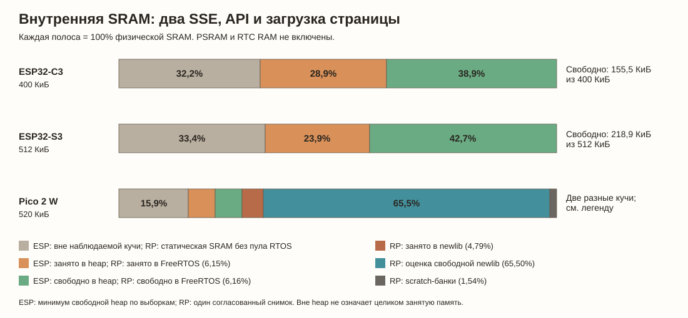

# Память веб-демо и запас для LVGL

Срез подготовлен 03.11.2026 по 10-минутным прогонам compact-демо: два SSE,
один API-клиент и повторная загрузка страницы. Это память **всей работающей
прошивки**, включая Wi‑Fi и ОС, а не стоимость одного NaWServer. OTA измерялась
отдельно. Исходные сценарии и ограничения — в [подробном отчёте](RESOURCE_RESULTS_RU.md).

## Что именно показано

| Сегмент | C3, байт (% SRAM) | S3, байт (% SRAM) | Pico, байт (% SRAM) |
|---|---:|---:|---:|
| Всего внутренняя SRAM | 409 600 (100%) | 524 288 (100%) | 532 480 (100%) |
| Вне наблюдаемой кучи ESP / статическая область Pico без пула FreeRTOS | 131 992 (32,22%) | 174 932 (33,37%) | 84 432 (15,86%) |
| Занято в куче ESP / пуле FreeRTOS Pico | 118 396 (28,91%) | 125 236 (23,89%) | 32 760 (6,15%) |
| Свободно в куче ESP / пуле FreeRTOS Pico | 159 212 (38,87%) | 224 120 (42,75%) | 32 776 (6,16%) |
| Занято в newlib Pico | — | — | 25 528 (4,79%) |
| Оценка свободной области newlib Pico | — | — | 348 792 (65,50%) |
| Отдельные scratch-банки Pico | — | — | 8 192 (1,54%) |

Для ESP взяты минимумы свободной внутренней 8-битной кучи по выборкам и
соответствующая ёмкость этой кучи. Оставшаяся часть SRAM определена по
разности: в ней могут быть код, статические данные, cache и другие области.
**Это не доказательство, что каждый байт за пределами кучи занят или доступен
приложению.** Внешняя PSRAM и RTC RAM в знаменатель не включены.

Для Pico показан один согласованный снимок на 20,1 секунде: нельзя сложить
независимые минимумы двух областей как будто они были в один момент. Статические
149 968 Б уже включают пул FreeRTOS 65 536 Б, поэтому пул разложен на занятую и
свободную части и не добавлен повторно. FreeRTOS и newlib — разные области:
свободное место одной не всегда можно отдать другой. Оценка newlib получена из
границ области и данных аллокатора, а не измерением крупнейшего непрерывного
блока. Scratch-банки не объявляются целиком свободными.

Минимумы за весь 600-секундный прогон: Pico FreeRTOS 32 776 / 65 536 Б,
newlib 346 864 / 374 320 Б; эти минимумы могли наступить в разное время. На
ESP минимум размера крупнейшего свободного непрерывного блока по выборкам: C3 **114 688 Б**, S3
**180 224 Б**. Это важнее общей свободной суммы, когда нужен большой буфер;
для DMA пригодность проверяется отдельно. Кратковременные пики могли попасть
между выборками. S3 данной платы имеет ещё 8 МиБ внешней PSRAM: её нельзя
незаметно прибавлять к внутренней SRAM или считать всю пригодной для DMA.

## Поместится ли LVGL?

Для примера S3 с экраном **320 × 170 RGB565**:
два частичных DMA-буфера по `320 × 20 × 2 = 12 800 Б`, всего **25 600 Б** —
4,88% внутренней SRAM S3.
Буферы выделяются с `MALLOC_CAP_DMA | MALLOC_CAP_INTERNAL`.

| Буферы 320 × 170, RGB565 | Размер | От SRAM C3 | От SRAM S3 | Что это значит |
|---|---:|---:|---:|---|
| Один буфер на 20 строк | 12 800 Б | 3,13% | 2,44% | Текущий размер одного буфера проекта |
| Два буфера по 20 строк | 25 600 Б | 6,25% | 4,88% | Текущая схема S3 |
| Один полный кадр | 108 800 Б | 26,56% | 20,75% | На C3 близко к измеренному крупнейшему блоку 114 688 Б |
| Два полных кадра | 217 600 Б | 53,13% | 41,50% | Нельзя судить о пригодности только по общей свободной сумме |

Это **только пиксельные буферы**. Дополнительно нужны память объектов, стилей,
шрифтов, изображений, дисплейного драйвера, стек задачи LVGL и запас под Wi‑Fi,
API и OTA. В [требованиях LVGL 9.2](https://lvgl.io/docs/open/9.2/intro/)
для нескольких объектов рекомендовано более 48 КБ динамической памяти и более
8 КБ стека; это ориентир разработчиков LVGL, не замер вашего интерфейса.
[Частичный буфер LVGL](https://lvgl.io/docs/open/9.2/porting/display) позволяет
рисовать экран участками; два буфера не обязательны.

Предварительный вывод: **S3 выглядит пригодным кандидатом** для существующих
частичных буферов и интерфейса; при наличии PSRAM есть дополнительный запас
для подходящих данных. C3 тоже имеет запас для небольшого интерфейса с частичным
буфером, но требует более осторожного бюджета; полный кадр почти выбирает
крупнейший измеренный блок. На Pico запас в newlib выглядит большим, однако
непрерывность и размещение памяти, а также вывод на конкретный дисплей ещё
нужно проверить. Ни одна из этих оценок не доказывает работу **LVGL + веб + OTA**:
для неё нужен совместный замер на реальной плате с DMA-capable heap, крупнейшим
DMA-блоком, минимумами и полноценной сценой LVGL.

## Внешние ориентиры: разные условия

Прямого опубликованного сравнения серверов в одинаковых условиях пока нет.
Тем не менее показываем наши результаты рядом с ориентирами. Процент считается
как **(наш показатель − ориентир) / ориентир**; знак «−» в таблице означает,
что у нашей прошивки показано меньше свободной памяти. Из-за разных сценариев
он **не равен разнице затрат серверов**.

| Ориентир | Ориентир: свободная память | NaWServer compact: свободная память | Разница от ориентира | Насколько сопоставимо |
|---|---:|---:|---:|---|
| [Наш прежний native HTTPD, C3](MEASUREMENTS.md) | 178 676 Б, один снимок | C3: 159 212 Б, минимум по выборкам за 10 минут с двумя SSE, API и страницами | −19 464 Б / **−10,89%** | Та же плата; другая демка и фаза. Прежний снимок — не минимум текущего сценария. |
| Тот же прежний HTTPD, C3 | 178 676 Б | C3: 165 032 Б, второй снимок простоя | −13 644 Б / **−7,64%** | Это ближе к сравнению простоя, но исходный снимок сделан после иных браузерных/SSE проверок. |
| Исторические минимумы тех же C3 | 155 580 Б | 147 388 Б | −8 192 Б / **−5,27%** | Минимумы накоплены с запуска разных прошивок и отражают разные сценарии; это не одинаковый интервал измерения. |
| [Espressif IDF, C3 Wi‑Fi Station](https://docs.espressif.com/projects/esp-techpedia/en/latest/esp-friends/advanced-development/system/ram-usage.html) | 219 K | C3: 159 212 Б с веб-нагрузкой | **примерно −27…−29%** | У Espressif только Wi‑Fi, без нашего веб-сценария; «K» в таблице не расшифровано, диапазон охватывает 1000 и 1024 Б. |
| [Espressif IDF, S3 Wi‑Fi Station](https://docs.espressif.com/projects/esp-techpedia/en/latest/esp-friends/advanced-development/system/ram-usage.html) | 273 K | S3: 224 120 Б с веб-нагрузкой | **примерно −18…−20%** | Те же ограничения по сценарию и единице K. |
| [PsychicHttp](https://github.com/hoeken/PsychicHttp) | около 150 K свободно в пустом примере | C3: 159 212 Б; S3: 224 120 Б под нагрузкой | C3: примерно **+4…+6%**; S3: **+46…+49%** | Плата, конфигурация и единица K в источнике не уточнены. Это грубое сопоставление свободного остатка, не рейтинг. |

Остальные опубликованные цифры измеряют другое, но рядом показано, какого
именно числа не хватает у нас для полноценного сравнения:

| Ориентир | У них | У нас | Разница | Почему |
|---|---:|---:|---:|---|
| [ESP-IDF HTTPD: запуск](https://github.com/espressif/esp-idf/issues/14266) | Расход при запуске HTTPD: 20 128 Б | Отдельный прирост при запуске нашего веба на той же сборке **не измерен** | Не вычисляется | У них другая ESP32 и стек 16 348 Б; свободную память всей нашей прошивки нельзя вычитать из расхода запуска. |
| [AsyncTCP: значение по умолчанию](https://github.com/ESP32Async/AsyncTCP/blob/main/src/AsyncTCP.h), [настройка](https://esp32async.github.io/ESPAsyncWebServer/configuration/) | Стек AsyncTCP по умолчанию 16 384 Б; предлагаются 4–8 КиБ | Стек нашего HTTP worker на ESP 8 192 Б | **−50% к 16 КиБ**; к 8 КиБ — 0%, к 4 КиБ — +100% | Это только размер **одной** задачи; остальные стеки и полное потребление серверов не учтены. |
| [Mongoose на STM32](https://mongoose.ws/articles/tcp-ip-footprint/) | Занято heap: 10 020 Б при старте, 11 636 Б с одним соединением | Эквивалентный прирост нашего heap не измерен | Не вычисляется | STM32, Ethernet и bare metal; это не свободный остаток и не вся RAM прошивки. |

## Что такое newlib

[newlib](https://sourceware.org/newlib/info.html) — стандартная библиотека C
для встраиваемых устройств: в ней, например, есть функции строк, `printf`,
`malloc` и `free`. Это не отдельная микросхема и не дополнительная память.

В **нашей конфигурации Pico** для `malloc`/C++ выделяется область newlib, а
FreeRTOS использует собственный заранее выделенный пул для своих задач и других
объектов. Оба находятся в одной физической SRAM, но распределяются разными
аллокаторами: свободные 32 КиБ в пуле FreeRTOS нельзя автоматически потратить
через `malloc`, и наоборот. Граница пулов зависит от конкретной сборки, а не
является неизменным свойством Pico или newlib.

Аппаратные пределы SRAM: [ESP32-C3](https://documentation.espressif.com/esp32-c3_datasheet_en.html),
[ESP32-S3](https://documentation.espressif.com/esp32_s3_datasheet_en.pdf),
[RP2350](https://www.raspberrypi.com/documentation/microcontrollers/microcontroller-chips.html).
