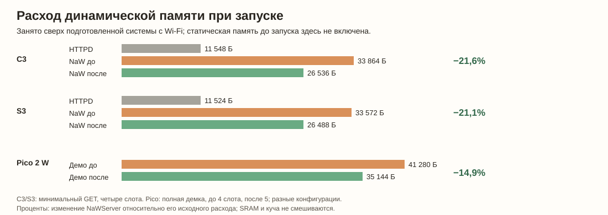

# TX-очередь: сравнение памяти и нагрузки

## Что изменено

Метаданные TX больше не содержат безусловные таблицы на 64 соединения и
32 задания. Таблицы выделяются один раз по настройкам backend; количество
handles включает не только клиентские сессии, но и listener, ingress,
keep-alive и запас на временно принятый handle. Payload имеет собственную
политику размещения. Описание аллокаторов и бюджетов:
[память TCP TX](../../docs/readme_tcp_tx_memory_ru.md).

Во всех сравнениях необходимо учитывать и резерв в `.bss`, и динамическую
кучу. Статическая арена уменьшает доступную кучу, но не создаёт новую RAM.
Числа — измерения всей указанной прошивки; условия сравниваемых образов
приведены рядом. Сырые исследовательские артефакты хранятся в игнорируемых
локальных каталогах; они не содержатся в репозитории.

## Запуск минимальных серверов на ESP

Одинаковая плата/IDF 5.5.6/Wi‑Fi, четыре клиентских слота, 8192 Б HTTP-стек,
один GET с одинаковым ответом; PSRAM отключена. HTTPD — прогретый запуск с
одним URI. NaWServer — первый запуск с TX worker, очередью и собственным
исполнителем. Heap только internal/8bit; BSS до первого снимка не входит.

| Плата | HTTPD, Б | NaW до изменения, Б | NaW после изменения, Б | Экономия NaW | Разница с HTTPD после |
|---|---:|---:|---:|---:|---:|
| C3 | 11 548 | 33 864 | 26 536 | **−7 328 Б / −21,64%** | +14 988 Б / +129,8% |
| S3 | 11 524 | 33 572 | 26 488 | **−7 084 Б / −21,10%** | +14 964 Б / +129,8% |

Старый и новый ELF собраны отдельно; их конфигурации и SHA сохранены.
Промежуточные значения относятся к рабочим образам до исправлений, не меняющих
успешный путь, и включают накладные расходы конкретных тестовых аллокаторов.
Не следует приписывать каждый байт только сокращению таблиц. Это не сравнение
двух одинаковых полнофункциональных приложений с SSE и OTA. Подробная исходная
методика: [замер до оптимизации](STARTUP_MEMORY_RU.md).

ESP metadata capacity в этом опыте: 8 handles и 3 задания, фактический запрос
**848 Б**. При пятом клиентском слоте пример демки запросил бы больше. Отказ
выделения/нехватка арены приводят к отказу старта, а не неограниченному росту.

## Pico: размещение и реальный обмен

Каждая строка — подключённый Wi‑Fi, отдельный старт, idle10, затем 60 секунд
с двумя SSE, API и повторной загрузкой страницы и отдельное OTA. Static SRAM
включает диагностический endpoint, который запускается уже после стартовых
снимков. 4-slot ELF собран до исправления `SO_REUSE` и rollback неудачного
старта; 5-slot ELF включает исправления. Одна попытка на конфигурацию, фоновый
LocalPortal включён.

| Метаданные / payload | Клиенты | Static SRAM, Б | FreeRTOS после старта, Б свободно | Newlib после старта, Б занято | Метаданные, Б | CPU нагрузки | Результат |
|---|---:|---:|---:|---:|---:|---:|---|
| Куча / по запросу | 4 | 150 128 | 33 400 | 18 656 | 848 | 4,30% | PASS |
| Куча / заранее из кучи | 4 | 150 128 | 33 400 | 21 752 | 848 | 4,28% | PASS |
| Куча / статически | 4 | 153 200 | 33 400 | 18 656 | 848 | 4,28% | PASS |
| Статика 1024 / по запросу | 4 | 151 156 | 33 408 | 17 804 | 848 | 4,25% | PASS |
| Статика 2048 / по запросу | 4 | 152 180 | 33 200 | 17 804 | 848 | 4,25% | FAIL: 503 API; первый restart отказал |
| Статика 1024 / payload статически | 4 | 154 228 | 33 408 | 17 804 | 848 | 4,21% | FAIL: 503 API |
| Куча / по запросу | 5 | 150 132 | 33 408 | 19 220 | 912 | 4,26% | PASS |
| Статика 1024 / по запросу | 5 | 151 160 | 33 400 | 18 296 | 912 | 4,38% | PASS |
| Статика 2048 / по запросу | 5 | 152 184 | 33 192 | 18 296 | 912 | 4,39% | PASS |

Для пяти слотов арена1024 уменьшила занятую newlib на 924 Б, но увеличила
статическую область на 1028 Б: суммарно около **104 Б дополнительного
резерва**, а не экономия. Три заранее выделенных блока 1024 Б заняли из кучи
3096 Б с накладными расходами; те же блоки статически уменьшили доступную
область newlib на 3072 Б. Разница CPU в отдельных минутных опытах недостаточна
для вывода о быстродействии.

Два отказа 503 при четырёх слотах и один неудачный restart сохранены как FAIL;
конкретная причина первого restart не доказана. После исправления `SO_REUSE`
три контрольных цикла GET → stop → restart прошли. Три режима с пятью слотами
прошли короткую нагрузку и OTA. Production с пятью слотами выдержал 600 секунд:
570 API и 274 страницы без ошибок, по 299 событий каждого SSE, CPU 4,53%;
дополнительная stress-проба 60 секунд также прошла.

Для старого 4-slot full demo и нового 5-slot full demo стоимость запуска
составила 41 280 и 35 144 Б соответственно, **−6136 Б / −14,86%**. Новый
образ также имеет отличия в лимитах и конфигурации lwIP, поэтому эта разница
характеризует сборки целиком, а не изолированно только таблицы TX. Сопоставление
600-секундного остатка newlib: 346 864 → 352 976 Б, +6112 Б / +1,76% от
прежнего остатка; использовались разные 4/5-slot конфигурации.

## S3: перемещение в PSRAM

Подробное сравнение по категориям, объёмам и ограничениям — в
[таблицах S3/PSRAM](PSRAM_PLACEMENT_MEASUREMENTS_RU.md). Основная серия
сопоставляет четыре размещения метаданных и payload при одинаковом PSRAM-on
SDK. Испытаны заранее выделенные 3, 32 и 48 КиБ, а также отдельная широкая
политика `malloc`; содержимое крупных передач проверялось на стороне клиента.

В условиях 32 КиБ перенос метаданных и payload из internal в PSRAM снизил
динамический startup с 74 656 до 40 324 Б — **на 34 332 Б / 45,99%** от
исходного startup. Перенос 48 КиБ снизил его с 91 524 до 40 312 Б —
**на 51 212 Б / 55,95%**. Это сравнение при уже включённой PSRAM; включение
PSRAM само по себе уменьшило доступную internal heap примерно на 6,7 КиБ.
Единичные замеры скорости не позволяют объявить небольшие различия влиянием
PSRAM. При усиленной нагрузке в большинстве вариантов строгий критерий SSE
не прошёл; подробности и прежние 503/RST приведены в отдельном отчёте.
